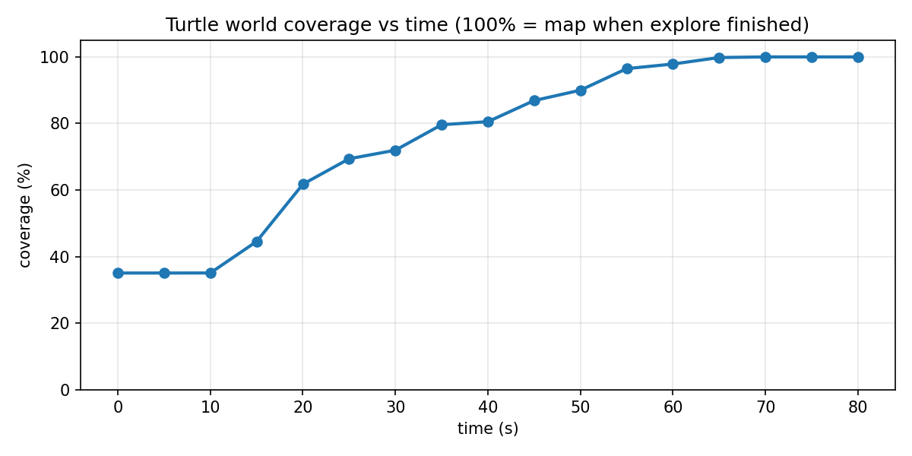

# Swarm Search — Autonomous Multi-Robot Search & Rescue (ROS 2 Humble)

Autonomous indoor multi-robot exploration in Gazebo Classic: **three TurtleBot3 Burgers** concurrently run online SLAM and Nav2, merge local laser scans into a unified real-time team occupancy grid (`/shared_map`), and **autonomously map complex multi-room environments** (`turtlebot3_house`) using cluster-based frontier detection and intelligent coordinated goal assignment.

Coverage of the environment is tracked and logged over time for quantitative benchmarking.

---

## Key Highlights & Innovations

- **Namespaced Multi-Robot Architecture**: Full multi-robot bringup with independent namespaced TF trees (`TB3_1`, `TB3_2`, `TB3_3`), individual SLAM nodes, and Nav2 stacks.
- **Ground-Truth Map Merging (`map_merge_swarm`)**: Fuses local laser occupancy grids into a single, high-fidelity `/shared_map` with real-time ground-truth spatial alignment.
- **Doorway-Preserving Frontier Detection (`frontier_detector`)**: Connected-component clustering calibrated with `MIN_CLUSTER_SIZE = 7` to retain critical ~8-cell doorway clusters while filtering map noise.
- **Intelligent Swarm Coordinator (`goal_assigner`)**: Implements an advanced 6-pattern multi-robot coordination architecture:
  1. **Clearance-Aware Backoff**: Offsets target goals from frontier boundaries along the robot vector (0.4m, 0.3m, 0.6m, 0.9m) and radial rings, strictly requiring confirmed free space (`value == 0`) with safety clearance $\ge 0.22\text{m}$.
  2. **Dynamic Spatial Claims**: Enforces a $1.2\text{m}$ mutual exclusion radius to prevent redundant multi-robot assignments to the same local area.
  3. **Progressive Blacklisting & Retry Budget**: Distinguishes transient aborts (60s hold) from permanent unreachable obstacle shadows (2-visit threshold blacklists unreachable points for 600s).
  4. **Active Watchdog & Escape Recoveries**: Detects kinematic stalls ($< 0.3\text{m}$ movement over 20s) and idle robots (10s without valid frontiers), issuing clearance-ranked escape nudges into open space.
  5. **Soft-Cost Ranking & Room Dispersion**:
     $$
     \text{Cost}(f) = d_{\text{self}} + \text{gap\_cost} + \text{wall\_cost} + \text{disperse\_penalty}
     $$
     Biases robots to systematically explore their current room before transitioning through doorways, while repelling robots away from teammates with a $1.2\text{m}$ personal bubble.
  7. **In-Flight Redirection**: Dynamically re-assigns robots that are en route to distant rooms ($> 3.0\text{m}$) if closer local frontiers ($\le 1.5\text{m}$) appear nearby, with 10s hysteresis to eliminate thrashing.
- **Smooth Hallway & Corner Traversal**: Costmaps tuned with `cost_scaling_factor: 3.0` and Regulated Pure Pursuit (RPP) to center robots down hallways and eliminate corner-clipping on 90° interior walls.

---

## System Stack

| Subsystem | Technology |
|---|---|
| **OS** | Ubuntu 22.04 LTS (Native / WSL2 tested) |
| **Middleware** | ROS 2 Humble Hawksbill |
| **Simulator** | Gazebo Classic 11 |
| **Robots** | 3× TurtleBot3 Burger (differential drive) |
| **SLAM** | `slam_toolbox` (online asynchronous, namespaced) |
| **Navigation** | Nav2 (`NavfnPlanner` with A* + Regulated Pure Pursuit controller) |
| **Map Fusion** | `map_merge_swarm` (Ground-truth TF alignment + live fusion) |
| **Coordination** | `explore_swarm` (Frontier detection + 6-pattern goal assigner) |

---

## Repository Structure

```text
swarm-search/
├── launch/                 # Multi-robot Gazebo spawn, SLAM, Nav2, localization
│   ├── multi_robot_spawn.launch.py   # Spawns 3 TB3s in turtlebot3_house
│   ├── slam_tb3.launch.py            # Namespaced SLAM bringup
│   ├── nav2_tb3.launch.py            # Namespaced Nav2 bringup
│   └── nav2_tb3_localization.launch.py
├── nav2_params/            # Calibrated Nav2 configs (burger_tb3_1/2/3.yaml)
├── slam_params/            # Calibrated SLAM configs (mapper_params_tb3_1/2/3.yaml)
├── worlds/                 # Gazebo worlds (turtlebot3_house.world, etc.)
├── maps/                   # Saved baseline and live team maps (house_shared*)
├── analysis/               # Coverage logger, CSV logs, and plotting scripts
├── docs/                   # Architecture notes, pattern designs, and runbook
├── src/
│   ├── map_merge_swarm/    # Multi-robot map merger and TF broadcaster
│   └── explore_swarm/      # Frontier detector, goal assigner, explore.launch.py
└── archive/                # Historical prototype assets
```

---

## Prerequisites & Installation

### 1. System Dependencies
Ensure ROS 2 Humble and TurtleBot3 simulation packages are installed:
```bash
sudo apt update
sudo apt install -y \
  ros-humble-desktop \
  ros-humble-navigation2 \
  ros-humble-nav2-bringup \
  ros-humble-slam-toolbox \
  ros-humble-turtlebot3* \
  ros-humble-gazebo-ros-pkgs \
  python3-scipy \
  python3-numpy \
  python3-matplotlib
```

### 2. Environment Setup
Add to your `~/.bashrc`:
```bash
export TURTLEBOT3_MODEL=burger
export GAZEBO_MODEL_PATH=$GAZEBO_MODEL_PATH:/opt/ros/humble/share/turtlebot3_gazebo/models
```

### 3. Build Workspace
```bash
cd ~/swarm-search
source /opt/ros/humble/setup.bash
colcon build --packages-select map_merge_swarm explore_swarm
source install/setup.bash
```

---

## Running Autonomous Swarm Exploration

Launch the system across terminals **T0–T9**. In each terminal, first source the environment:
```bash
source /opt/ros/humble/setup.bash
source ~/swarm-search/install/setup.bash
export TURTLEBOT3_MODEL=burger
export GAZEBO_MODEL_PATH=$GAZEBO_MODEL_PATH:/opt/ros/humble/share/turtlebot3_gazebo/models
cd ~/swarm-search
```

### Terminal Workflow Overview

| Terminal | Module | Description |
|---|---|---|
| **T0** | **Gazebo Simulation** | Spawns 3 TurtleBot3s in `turtlebot3_house` |
| **T1** | **SLAM (TB3_1)** | Mapping for Robot 1 (`TB3_1/map`) |
| **T2** | **SLAM (TB3_2)** | Mapping for Robot 2 (`TB3_2/map`) |
| **T3** | **SLAM (TB3_3)** | Mapping for Robot 3 (`TB3_3/map`) |
| **T4** | **Nav2 (TB3_1)** | Navigation stack for Robot 1 |
| **T5** | **Nav2 (TB3_2)** | Navigation stack for Robot 2 |
| **T6** | **Nav2 (TB3_3)** | Navigation stack for Robot 3 |
| **T7** | **Map Merger** | Fuses scans into `/shared_map` |
| **T8** | **RViz2 Visualization** | Displays `/shared_map`, plans, and frontiers |
| **T9** | **Autonomous Exploration** | Frontier detection and coordinated assignment |

---

### Step-by-Step Commands

#### T0 — Gazebo Simulation
```bash
mkdir -p ~/swarm-search/launch/tmp_sdf
ros2 launch ~/swarm-search/launch/multi_robot_spawn.launch.py use_sim_time:=true
```

#### T1–T3 — SLAM (One per Robot)
```bash
# T1
ros2 launch ~/swarm-search/launch/slam_tb3.launch.py robot_ns:=TB3_1 use_sim_time:=true slam_params_file:=$HOME/swarm-search/slam_params/mapper_params_tb3_1.yaml

# T2
ros2 launch ~/swarm-search/launch/slam_tb3.launch.py robot_ns:=TB3_2 use_sim_time:=true slam_params_file:=$HOME/swarm-search/slam_params/mapper_params_tb3_2.yaml

# T3
ros2 launch ~/swarm-search/launch/slam_tb3.launch.py robot_ns:=TB3_3 use_sim_time:=true slam_params_file:=$HOME/swarm-search/slam_params/mapper_params_tb3_3.yaml
```

#### T4–T6 — Nav2 (Start after SLAM map TFs appear)
```bash
# T4
ros2 launch ~/swarm-search/launch/nav2_tb3.launch.py robot_ns:=TB3_1 use_sim_time:=true params_file:=$HOME/swarm-search/nav2_params/burger_tb3_1.yaml

# T5
ros2 launch ~/swarm-search/launch/nav2_tb3.launch.py robot_ns:=TB3_2 use_sim_time:=true params_file:=$HOME/swarm-search/nav2_params/burger_tb3_2.yaml

# T6
ros2 launch ~/swarm-search/launch/nav2_tb3.launch.py robot_ns:=TB3_3 use_sim_time:=true params_file:=$HOME/swarm-search/nav2_params/burger_tb3_3.yaml
```

#### T7 — Real-Time Map Fusion
```bash
ros2 launch map_merge_swarm map_merge.launch.py
```

#### T8 — RViz2
```bash
ros2 run rviz2 rviz2 --ros-args -p use_sim_time:=true
```
*Setup in RViz:*
- **Fixed Frame**: `shared_map`
- **Map Topic**: `/shared_map`
- **Frontier Markers**: MarkerArray `/frontiers_markers`
- **Robot Plans**: Path `/TB3_1/plan`, `/TB3_2/plan`, `/TB3_3/plan`

#### T9 — Autonomous Swarm Exploration
```bash
ros2 launch explore_swarm explore.launch.py
```

---

## Quantitative Evaluation & Coverage Benchmarking

To record exploration coverage progression over time:

1. **Start the logger** (run in a separate terminal before launching exploration):
   ```bash
   cd ~/swarm-search/analysis
   python3 coverage_logger.py
   ```
2. **Start autonomous exploration** (T9).
3. Once the environment is mapped, press **Ctrl+C** on the logger.
4. **Generate the coverage curve**:
   ```bash
   python3 plot_coverage.py
   ```



---

## Operational Notes & Troubleshooting

- **Costmap Gradient (`cost_scaling_factor: 3.0`)**: Softens obstacle cost gradients, forcing global paths to center in narrow corridors (~0.9m) and preventing RPP from clipping 90° interior doorway corners.
- **Goal Tolerance (`xy_goal_tolerance: 0.25`)**: Relaxed from 0.20m to 0.25m to prevent false controller timeouts when terminating near obstacle boundaries.
- **Unreachable Obstacle Shadows**: Handled automatically by the 2-visit counter in `goal_assigner.py`; if a frontier centroid cannot be cleared after 2 completed visits, it is blacklisted for 600s.
- **Clean Shutdown**: To reset Gazebo and ROS processes between runs:
  ```bash
  pkill -9 gzserver; pkill -9 gzclient
  ros2 daemon stop; ros2 daemon start
  ```

---

## License

This project is licensed under the MIT License.
