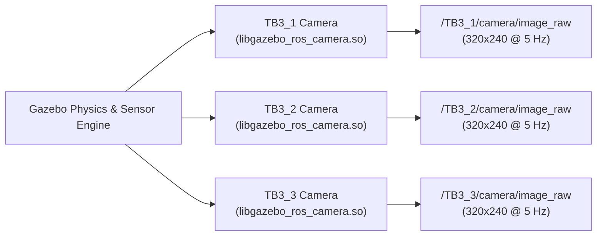

> **📍 Phase 3 › Stage 1 (Forward Cameras)** · [← Roadmap](../swarm_search_rescue_roadmap_v4.md) · [← P3 Runbook](P3-runbook.md) · Status: ✅ 100% Complete & Verified (Cameras active in Gazebo, rqt, and RViz)

# Stage 1: Add Forward RGB Cameras to TurtleBot3 Swarm
### Step-by-step technical guide for equipping TB3_1, TB3_2, and TB3_3 with simulated camera sensors

---

## 1. Goal & Architectural Overview

In this stage, you will upgrade all three TurtleBot3 Burgers by mounting a **forward-facing RGB camera** on each robot:



### The Clean Design Pattern (No `sudo` / No System Pollution)
* **The Wrong Way**: Modifying files inside `/opt/ros/humble/share/turtlebot3_gazebo/` with `sudo`. (Risks breaking stock ROS, and changes get deleted during `sudo apt upgrade`).
* **The Right Way**: Create a **local model definition** inside `~/swarm-search/models/turtlebot3_burger/` and point `multi_robot_spawn.launch.py` to your repo. All customizations stay tracked in Git.

---

## 2. Technical Deep-Dive: Camera Sensor Physics & Plugins

### 2.1 Sensor Positioning on the Burger
The TurtleBot3 Burger has a compact chassis. The ideal camera mounting location is right on the front edge of the top plate:
* **Position**: $x = +0.073\text{ m}$ (front), $y = 0.0\text{ m}$ (centered), $z = +0.115\text{ m}$ (above base).
* **Orientation**: Roll = $0$, Pitch = $0$, Yaw = $0$ (pointing straight ahead).

### 2.2 Optics Configuration (Matching Real Hardware)
To simulate a real-world Raspberry Pi Camera v2 or wide-angle webcam:
* **Horizontal FOV**: $1.085595\text{ rad} \approx 62.2^\circ$.
* **Resolution**: `320 × 240` (QVGA).
  * *Why QVGA?* Running three 30 FPS 1080p cameras in Gazebo requires rendering 60 million pixels/sec off-screen, stalling WSL2. At $320 \times 240$ and $5\text{ Hz}$, all 3 cameras combined require only $1.15\text{ million pixels/sec}$—smooth, lightweight, and perfectly readable by YOLOv8n.
* **Clip Planes**: Near = $0.05\text{ m}$, Far = $8.0\text{ m}$ (fits indoor rooms without rendering infinite background).

### 2.3 The ROS 2 Camera Plugin: `libgazebo_ros_camera.so`
In Gazebo Classic with ROS 2 Humble, `libgazebo_ros_camera.so` bridges Gazebo's camera renderer to standard ROS 2 message types:
* Publishes `sensor_msgs/msg/Image` on `<namespace>/camera/image_raw`.
* Publishes `sensor_msgs/msg/CameraInfo` on `<namespace>/camera/camera_info`.

---

## 3. Step-by-Step Implementation Guide

Follow these steps to implement Stage 1 yourself:

---

### Step 1: Copy Stock Burger Model into Your Workspace

Instead of modifying `/opt/ros/humble/`, create a dedicated local `models` directory:

```bash
cd ~/swarm-search
mkdir -p models/turtlebot3_burger
cp /opt/ros/humble/share/turtlebot3_gazebo/models/turtlebot3_burger/model.sdf models/turtlebot3_burger/
cp /opt/ros/humble/share/turtlebot3_gazebo/models/turtlebot3_burger/model.config models/turtlebot3_burger/
```

Verify that `models/turtlebot3_burger/model.sdf` exists in your project.

---

### Step 2: Add Camera Link, Joint, and Sensor to `model.sdf`

Open `models/turtlebot3_burger/model.sdf`. 

Inside the `<model name="turtlebot3_burger">` block (just before the closing `</model>` tag), add the camera link, sensor plugin, and fixed joint:

```xml
    <!-- ========================================== -->
    <!-- Forward RGB Camera Link and Sensor Plugin  -->
    <!-- ========================================== -->
    <link name="camera_link">
      <pose>0.073 0 0.115 0 0 0</pose>
      <inertial>
        <mass>0.01</mass>
        <inertia>
          <ixx>0.000001</ixx>
          <ixy>0.0</ixy>
          <ixz>0.0</ixz>
          <iyy>0.000001</iyy>
          <iyz>0.0</iyz>
          <izz>0.000001</izz>
        </inertia>
      </inertial>
      <visual name="camera_visual">
        <geometry>
          <box>
            <size>0.015 0.030 0.027</size>
          </box>
        </geometry>
        <material>
          <ambient>0.1 0.1 0.1 1.0</ambient>
          <diffuse>0.2 0.2 0.2 1.0</diffuse>
        </material>
      </visual>
      <sensor name="camera" type="camera">
        <always_on>true</always_on>
        <visualize>false</visualize>
        <update_rate>5.0</update_rate>
        <camera>
          <horizontal_fov>1.085595</horizontal_fov>
          <image>
            <width>320</width>
            <height>240</height>
            <format>R8G8B8</format>
          </image>
          <clip>
            <near>0.05</near>
            <far>8.0</far>
          </clip>
        </camera>
        <plugin name="camera_controller" filename="libgazebo_ros_camera.so">
          <ros>
            <namespace>TB3_1</namespace>
            <remapping>image_raw:=camera/image_raw</remapping>
            <remapping>camera_info:=camera/camera_info</remapping>
          </ros>
          <camera_name>camera</camera_name>
          <frame_name>TB3_1/camera_link</frame_name>
          <hack_baseline>0.07</hack_baseline>
        </plugin>
      </sensor>
    </link>

    <joint name="camera_joint" type="fixed">
      <parent>base_link</parent>
      <child>camera_link</child>
    </joint>
```

> [!NOTE]
> Notice the placeholders `<namespace>TB3_1</namespace>` and `<frame_name>TB3_1/camera_link</frame_name>`. In Step 3, our spawn launch script will automatically substitute the correct namespace for each robot!

---

### Step 3: Update `launch/multi_robot_spawn.launch.py`

Open [`launch/multi_robot_spawn.launch.py`](file:///home/pruth/swarm-search/launch/multi_robot_spawn.launch.py).

#### 3.1 Point `urdf_path` to your local repository model:
Change lines 45–51:
```python
    # Use the local model with camera sensor
    urdf_path = os.path.join(
        os.path.expanduser("~/swarm-search"),
        "models",
        model_folder,
        "model.sdf",
    )
```

#### 3.2 Add Camera XML Dynamic Remapping:
In the loop where `xml.etree.ElementTree` modifies frame names (around lines 95–105), add rules to rename the camera namespace and frame name for each robot:

```python
    for count in range(number_of_robots):
        tree = ET.parse(urdf_path)
        root = tree.getroot()
        
        # Existing remappings
        for odom_frame_tag in root.iter("odometry_frame"):
            odom_frame_tag.text = f"{namespace}_{count + 1}/odom"
        for base_frame_tag in root.iter("robot_base_frame"):
            base_frame_tag.text = f"{namespace}_{count + 1}/base_footprint"
        for scan_frame_tag in root.iter("frame_name"):
            # Update lidar or camera frames appropriately
            if "scan" in scan_frame_tag.text:
                scan_frame_tag.text = f"{namespace}_{count + 1}/base_scan"
            elif "camera" in scan_frame_tag.text:
                scan_frame_tag.text = f"{namespace}_{count + 1}/camera_link"
                
        # Remap the camera plugin namespace
        for plugin_tag in root.iter("plugin"):
            if plugin_tag.get("name") == "camera_controller":
                ns_tag = plugin_tag.find("./ros/namespace")
                if ns_tag is not None:
                    ns_tag.text = f"{namespace}_{count + 1}"
```

---

### Step 4: Broadcast `camera_link` TF (Robot State Publisher)

In ROS 2, visualization tools (like RViz) need to know where `TB3_n/camera_link` is relative to `TB3_n/base_footprint`.

In [`launch/multi_robot_spawn.launch.py`](file:///home/pruth/swarm-search/launch/multi_robot_spawn.launch.py), add a `static_transform_publisher` node for each robot in the spawn loop so RViz has the complete TF tree:

```python
from launch_ros.actions import Node

# Inside the robot spawn loop:
static_cam_tf = Node(
    package="tf2_ros",
    executable="static_transform_publisher",
    name=f"cam_tf_publisher_{count + 1}",
    namespace=f"{namespace}_{count + 1}",
    arguments=[
        "--x", "0.073",
        "--y", "0.0",
        "--z", "0.115",
        "--yaw", "0.0",
        "--pitch", "0.0",
        "--roll", "0.0",
        "--frame-id", f"{namespace}_{count + 1}/base_link",
        "--child-frame-id", f"{namespace}_{count + 1}/camera_link",
    ],
    parameters=[{"use_sim_time": True}],
)
```

---

## 4. Verification & Testing

Once implemented, run these commands to verify that all 3 cameras are active:

### 1. Launch Gazebo & Robots
```bash
cd ~/swarm-search
ros2 launch launch/multi_robot_spawn.launch.py use_sim_time:=true
```

### 2. Verify Topics Exist
In a new terminal:
```bash
ros2 topic list | grep camera
```
**Expected output:**
```text
/TB3_1/camera/camera_info
/TB3_1/camera/image_raw
/TB3_2/camera/camera_info
/TB3_2/camera/image_raw
/TB3_3/camera/camera_info
/TB3_3/camera/image_raw
```

### 3. Verify Publication Rate
```bash
ros2 topic hz /TB3_1/camera/image_raw
```
**Expected output:**
```text
average rate: 5.000
    min: 0.198s max: 0.202s std dev: 0.001s window: 5
```

### 4. View the Camera Feed
You can inspect the live video stream from any robot:
```bash
# Using rqt_image_view:
ros2 run rqt_image_view rqt_image_view
```
Select `/TB3_1/camera/image_raw` or `/TB3_2/camera/image_raw` from the dropdown. You should see the interior of the house world from the robot's perspective!

---

## 5. Troubleshooting & Gotchas

* **Issue 1: `gzserver` crashes with Segmentation Fault when spawning**
  * *Cause*: Missing `<format>R8G8B8</format>` or invalid clip range in `<camera>` block.
  * *Fix*: Verify the XML matches the snippet in Step 2 exactly.
* **Issue 2: Image is pitch black in RViz / rqt**
  * *Cause*: In Gazebo Classic, ambient lighting in `turtlebot3_house.world` can be dim inside windowless rooms.
  * *Fix*: Check Gazebo window to confirm the robot is not facing a dark wall; drive the robot forward into a lit room.
* **Issue 3: High CPU usage / simulation slowdown**
  * *Cause*: Camera `<update_rate>` set to 30.0 instead of 5.0.
  * *Fix*: Keep update rate at `5.0 Hz` and resolution at `320 x 240`.

---

## 6. Stage 1 Checklist

- [x] Create `models/turtlebot3_burger/` and copy stock model files
- [x] Add `<link name="camera_link">`, `<sensor name="camera">`, and `<joint name="camera_joint">` to `model.sdf`
- [x] Update `launch/multi_robot_spawn.launch.py` to point to the local model and dynamically rename camera tags
- [x] Add static TF publisher for `camera_link` in spawn launch
- [x] Verify topics and image streams with `ros2 topic hz`, `rqt_image_view`, and `RViz2` (Confirmed 5.0 Hz publication)

