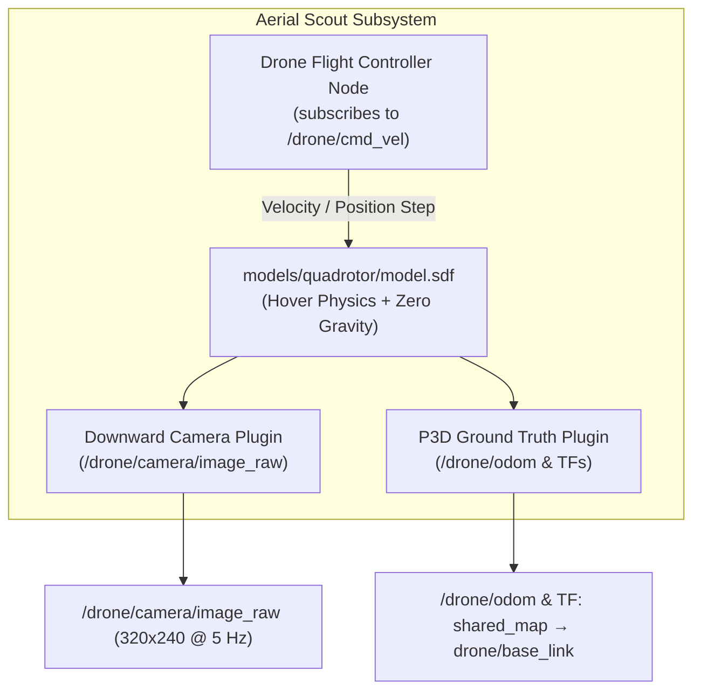

> **📍 Phase 3 › Stage 2 (Drone Bringup)** · [← Roadmap](../swarm_search_rescue_roadmap_v4.md) · [← P3 Runbook](P3-runbook.md) · Status: 🚀 Ready to Implement

# Stage 2: Gazebo Quadrotor Drone Model & Spawning
### Step-by-step technical guide for modeling, spawning, and controlling the aerial scout drone in Gazebo Classic

---

## 1. Goal & Architectural Overview

In this stage, you will introduce the **aerial tier** of your heterogeneous swarm: a simulated quadrotor drone that hovers at ceiling height above `turtlebot3_house`, streams a **top-down downward camera feed**, publishes 3D odometry, and moves via velocity commands (`/drone/cmd_vel`).



### Why this design pattern? (SITL / Kinematic Hover)
* **The Aerodynamic Pitfall**: In Gazebo Classic, low-level PID aerodynamic rotor plugins (like RotorS) frequently flip upside-down, tumble off walls, or require obsolete ROS 1 packages.
* **The Roadmap Choice**: Your roadmap locks in a **lightweight SITL / waypoint-controlled quadrotor**. Setting `<gravity>0</gravity>` on the airframe provides intrinsic altitude hold (hovering at $z = 2.2\text{ m}$ to $2.5\text{ m}$). It will **never tip, flip, or crash**, allowing you to focus on high-level swarm search logic.

---

## 2. Technical Deep-Dive: Drone Physics & Optics

### 2.1 Cruising Altitude in `turtlebot3_house`
The house world has interior partition walls 2.5 m tall, with no closed ceiling:
* **Operating Altitude**: $z = 2.8\text{ m}$ (30 cm above the 2.5m walls).
* **Advantage**: The drone flies straight over interior walls and furniture without getting trapped in narrow doorways, providing true aerial reconnaissance.

### 2.2 Downward Camera Optics
* **Mounting Pose**: $x = 0.0\text{ m}, y = 0.0\text{ m}, z = -0.05\text{ m}$.
* **Orientation (Pitching Down)**:
  $$\text{roll} = 0, \quad \text{pitch} = +1.570796\text{ rad} (+90^\circ), \quad \text{yaw} = 0$$
  This points the lens directly down at the floor.
* **FOV & Resolution**:
  * Horizontal FOV = $1.4\text{ rad} \approx 80^\circ$ (wide angle to capture whole rooms).
  * Resolution = `320 × 240` at `5.0 Hz` (lightweight, matches TurtleBot camera budget).

### 2.3 The 3D Odometry Plugin: `libgazebo_ros_p3d.so`
Publishes ground-truth 3D position, orientation, and linear/angular velocity directly from Gazebo physics:
* **Topic**: `/drone/odom` (`nav_msgs/msg/Odometry`).
* **Frame**: `shared_map` $\rightarrow$ `drone/base_link`.

---

## 3. Step-by-Step Implementation Guide

---

### Step 1: Create the Quadrotor Model Directory

In your workspace, create a new model folder:

```bash
cd ~/swarm-search
mkdir -p models/quadrotor
```

Create `models/quadrotor/model.config`:

```xml
<?xml version="1.0"?>
<model>
  <name>quadrotor</name>
  <version>1.0</version>
  <sdf version="1.6">model.sdf</sdf>
  <author>
    <name>Pruthvi Radadiya</name>
    <email>pruthviradadiya@gmail.com</email>
  </author>
  <description>
    Lightweight aerial scout quadrotor with downward camera and 3D odometry.
  </description>
</model>
```

---

### Step 2: Create `models/quadrotor/model.sdf`

Create `models/quadrotor/model.sdf` with a lightweight cross-airframe, downward camera, zero-gravity hover, and 3D odometry:

```xml
<?xml version="1.0" ?>
<sdf version="1.6">
  <model name="quadrotor">
    <static>false</static>

    <!-- Main Chassis Link -->
    <link name="base_link">
      <pose>0 0 0 0 0 0</pose>
      <gravity>0</gravity> <!-- Intrinsic hover stability: eliminates gravity drop -->

      <inertial>
        <mass>1.5</mass>
        <inertia>
          <ixx>0.0347563</ixx>
          <ixy>0</ixy>
          <ixz>0</ixz>
          <iyy>0.0458929</iyy>
          <iyz>0</iyz>
          <izz>0.0977</izz>
        </inertia>
      </inertial>

      <!-- Center Body Visual -->
      <visual name="body_visual">
        <geometry>
          <box>
            <size>0.25 0.25 0.08</size>
          </box>
        </geometry>
        <material>
          <ambient>0.8 0.1 0.1 1.0</ambient> <!-- Red center body -->
          <diffuse>0.8 0.1 0.1 1.0</diffuse>
        </material>
      </visual>

      <!-- Arm 1 Visual (X-axis) -->
      <visual name="arm_x">
        <pose>0 0 0 0 0 0</pose>
        <geometry>
          <box>
            <size>0.48 0.03 0.015</size>
          </box>
        </geometry>
        <material>
          <ambient>0.2 0.2 0.2 1.0</ambient>
          <diffuse>0.2 0.2 0.2 1.0</diffuse>
        </material>
      </visual>

      <!-- Arm 2 Visual (Y-axis) -->
      <visual name="arm_y">
        <pose>0 0 0 0 0 0</pose>
        <geometry>
          <box>
            <size>0.03 0.48 0.015</size>
          </box>
        </geometry>
        <material>
          <ambient>0.2 0.2 0.2 1.0</ambient>
          <diffuse>0.2 0.2 0.2 1.0</diffuse>
        </material>
      </visual>

      <!-- 4 Rotor Visuals -->
      <visual name="rotor_0">
        <pose>0.22 0 0.02 0 0 0</pose>
        <geometry><cylinder><radius>0.08</radius><length>0.005</length></cylinder></geometry>
        <material><ambient>0.1 0.1 0.1 0.7</ambient></material>
      </visual>
      <visual name="rotor_1">
        <pose>-0.22 0 0.02 0 0 0</pose>
        <geometry><cylinder><radius>0.08</radius><length>0.005</length></cylinder></geometry>
        <material><ambient>0.1 0.1 0.1 0.7</ambient></material>
      </visual>
      <visual name="rotor_2">
        <pose>0 0.22 0.02 0 0 0</pose>
        <geometry><cylinder><radius>0.08</radius><length>0.005</length></cylinder></geometry>
        <material><ambient>0.1 0.1 0.1 0.7</ambient></material>
      </visual>
      <visual name="rotor_3">
        <pose>0 -0.22 0.02 0 0 0</pose>
        <geometry><cylinder><radius>0.08</radius><length>0.005</length></cylinder></geometry>
        <material><ambient>0.1 0.1 0.1 0.7</ambient></material>
      </visual>

      <!-- Collision Shape -->
      <collision name="body_collision">
        <geometry>
          <box>
            <size>0.40 0.40 0.10</size>
          </box>
        </geometry>
      </collision>

      <!-- ============================================== -->
      <!-- Downward RGB Camera Sensor                     -->
      <!-- ============================================== -->
      <sensor name="downward_camera" type="camera">
        <!-- Pitched down by 90 deg (1.570796 rad) -->
        <pose>0 0 -0.05 0 1.570796 0</pose>
        <always_on>true</always_on>
        <update_rate>5.0</update_rate>
        <camera>
          <horizontal_fov>1.396263</horizontal_fov> <!-- 80 deg FOV -->
          <image>
            <width>320</width>
            <height>240</height>
            <format>R8G8B8</format>
          </image>
          <clip>
            <near>0.1</near>
            <far>10.0</far>
          </clip>
        </camera>
        <plugin name="camera_controller" filename="libgazebo_ros_camera.so">
          <ros>
            <namespace>drone</namespace>
            <remapping>image_raw:=camera/image_raw</remapping>
            <remapping>camera_info:=camera/camera_info</remapping>
          </ros>
          <camera_name>camera</camera_name>
          <frame_name>drone/camera_link</frame_name>
        </plugin>
      </sensor>
    </link>

    <!-- ============================================== -->
    <!-- Planar Velocity Controller (cmd_vel)           -->
    <!-- ============================================== -->
    <plugin name="drone_planar_move" filename="libgazebo_ros_planar_move.so">
      <ros>
        <namespace>drone</namespace>
        <remapping>cmd_vel:=cmd_vel</remapping>
        <remapping>odom:=odom_planar</remapping>
      </ros>
      <update_rate>30.0</update_rate>
      <robot_base_frame>base_link</robot_base_frame>
    </plugin>

    <!-- ============================================== -->
    <!-- 3D Odometry & Transform Broadcaster (P3D)      -->
    <!-- ============================================== -->
    <plugin name="p3d_base_controller" filename="libgazebo_ros_p3d.so">
      <ros>
        <namespace>drone</namespace>
        <remapping>odom:=odom</remapping>
      </ros>
      <body_name>base_link</body_name>
      <frame_name>shared_map</frame_name>
      <update_rate>20.0</update_rate>
      <xyz_offset>0 0 0</xyz_offset>
      <rpy_offset>0 0 0</rpy_offset>
      <gaussian_noise>0.001</gaussian_noise>
    </plugin>

  </model>
</sdf>
```

---

### Step 3: Create the Drone Controller Node (`drone_controller.py`)

To fly the drone smoothly in response to `/drone/cmd_vel`, create a lightweight Python controller node that integrates velocity into Gazebo model states.

Create file `src/explore_swarm/explore_swarm/drone_controller.py`:

```python
#!/usr/bin/env python3
"""
Drone Controller: Bridges /drone/cmd_vel into Gazebo model position & velocity.
Maintains ceiling cruise altitude (default z = 2.2m) with smooth velocity execution.
"""

import math
import rclpy
from rclpy.node import Node
from geometry_msgs.msg import Twist
from nav_msgs.msg import Odometry
from gazebo_msgs.srv import SetEntityState
from gazebo_msgs.msg import EntityState


class DroneController(Node):
    def __init__(self):
        super().__init__('drone_controller')
        self.target_z = 2.2  # Cruising altitude
        self.current_x = 0.0
        self.current_y = 0.0
        self.current_z = self.target_z
        self.current_yaw = 0.0

        self.vx = 0.0
        self.vy = 0.0
        self.vz = 0.0
        self.wz = 0.0

        # Subscribe to cmd_vel
        self.cmd_sub = self.create_subscription(
            Twist,
            '/drone/cmd_vel',
            self._cmd_vel_callback,
            10
        )

        # Subscribe to odom to track current position
        self.odom_sub = self.create_subscription(
            Odometry,
            '/drone/odom',
            self._odom_callback,
            10
        )

        # Service client for setting Gazebo entity state
        self.state_client = self.create_client(SetEntityState, '/gazebo/set_entity_state')

        # Control loop at 20 Hz
        self.timer = self.create_timer(0.05, self._update_loop)
        self.get_logger().info("Drone Controller initialized (Cruising altitude: 2.2m)")

    def _cmd_vel_callback(self, msg: Twist):
        self.vx = msg.linear.x
        self.vy = msg.linear.y
        self.vz = msg.linear.z
        self.wz = msg.angular.z

    def _odom_callback(self, msg: Odometry):
        pos = msg.pose.pose.position
        self.current_x = pos.x
        self.current_y = pos.y
        self.current_z = pos.z

        # Extract yaw from quaternion
        q = msg.pose.pose.orientation
        siny_cosp = 2.0 * (q.w * q.z + q.x * q.y)
        cosy_cosp = 1.0 - 2.0 * (q.y * q.y + q.z * q.z)
        self.current_yaw = math.atan2(siny_cosp, cosy_cosp)

    def _update_loop(self):
        if not self.state_client.service_is_ready():
            return

        dt = 0.05
        # Transform cmd_vel from body frame to world frame
        cos_yaw = math.cos(self.current_yaw)
        sin_yaw = math.sin(self.current_yaw)
        world_vx = self.vx * cos_yaw - self.vy * sin_yaw
        world_vy = self.vx * sin_yaw + self.vy * cos_yaw

        new_x = self.current_x + world_vx * dt
        new_y = self.current_y + world_vy * dt
        # Altitude: allow vz nudges, but default-clamp toward target_z
        new_z = self.current_z + self.vz * dt
        if abs(new_z - self.target_z) > 0.5 and self.vz == 0.0:
            new_z += 0.05 * (self.target_z - new_z)  # Soft spring to cruising altitude

        new_yaw = self.current_yaw + self.wz * dt

        # Prepare state request
        req = SetEntityState.Request()
        req.state.name = 'quadrotor'
        req.state.reference_frame = 'shared_map'
        req.state.pose.position.x = new_x
        req.state.pose.position.y = new_y
        req.state.pose.position.z = new_z

        # Convert new_yaw back to quaternion
        req.state.pose.orientation.z = math.sin(new_yaw / 2.0)
        req.state.pose.orientation.w = math.cos(new_yaw / 2.0)

        # Call service asynchronously
        self.state_client.call_async(req)


def main(args=None):
    rclpy.init(args=args)
    node = DroneController()
    try:
        rclpy.spin(node)
    except KeyboardInterrupt:
        pass
    finally:
        node.destroy_node()
        rclpy.shutdown()


if __name__ == '__main__':
    main()
```

Register this node in `src/explore_swarm/setup.py`:
```python
    entry_points={
        'console_scripts': [
            # ... existing nodes ...
            'drone_controller = explore_swarm.drone_controller:main',
        ],
    },
```

Rebuild the package:
```bash
cd ~/swarm-search
colcon build --packages-select explore_swarm
source install/setup.bash
```

---

### Step 4: Create Launch File `launch/drone_spawn.launch.py`

Create `launch/drone_spawn.launch.py` to spawn the quadrotor at $z = 2.2\text{ m}$ and launch its controller:

```python
import os
from launch import LaunchDescription
from launch_ros.actions import Node
from ament_index_python.packages import get_package_share_directory


def generate_launch_description():
    sdf_path = os.path.expanduser("~/swarm-search/models/quadrotor/model.sdf")

    # Spawn quadrotor entity at (0.0, 0.0, 2.2)
    spawn_drone = Node(
        package="gazebo_ros",
        executable="spawn_entity.py",
        arguments=[
            "-entity", "quadrotor",
            "-file", sdf_path,
            "-x", "0.0",
            "-y", "0.0",
            "-z", "2.2",
            "-Y", "0.0",
        ],
        output="screen",
    )

    # Static TF for drone downward camera frame
    drone_cam_tf = Node(
        package="tf2_ros",
        executable="static_transform_publisher",
        name="drone_cam_tf_publisher",
        arguments=[
            "--x", "0.0",
            "--y", "0.0",
            "--z", "-0.05",
            "--roll", "0.0",
            "--pitch", "1.570796",
            "--yaw", "0.0",
            "--frame-id", "drone/base_link",
            "--child-frame-id", "drone/camera_link",
        ],
        parameters=[{"use_sim_time": True}],
    )

    # Drone velocity flight controller
    drone_controller = Node(
        package="explore_swarm",
        executable="drone_controller",
        name="drone_controller",
        parameters=[{"use_sim_time": True}],
        output="screen",
    )

    return LaunchDescription([
        spawn_drone,
        drone_cam_tf,
        drone_controller,
    ])
```

---

## 4. Verification & Flight Testing

### 1. Launch Multi-Robot Gazebo
```bash
cd ~/swarm-search
export TURTLEBOT3_MODEL=burger
ros2 launch launch/multi_robot_spawn.launch.py use_sim_time:=true
```

### 2. Spawn the Drone
You have two interchangeable drone models:
* **Option A: Realistic 3D Mesh Drone** (Default):
  ```bash
  ros2 launch launch/drone_spawn.launch.py model:=quadrotor
  ```
  *(To download the 3D mesh: `curl -L "https://models.gazebosim.org/quadrotor/model.tar.gz" | tar -xz -C /tmp/ && cp -r /tmp/quadrotor/meshes/* models/quadrotor/meshes/`)*

* **Option B: Lightweight Geometric Box Drone**:
  ```bash
  ros2 launch launch/drone_spawn.launch.py model:=quadrotor_simple
  ```

---

### 3. Fly with Interactive Keyboard Teleop (WASD + 8456)

In a new terminal, launch the custom interactive flight teleop node:
```bash
source /opt/ros/humble/setup.bash
source ~/swarm-search/install/setup.bash
ros2 run explore_swarm drone_teleop
```

Controls:
* **`W` / `8` / `Up`**: Fly Forward
* **`S` / `2` / `Down`**: Fly Backward
* **`A` / `4` / `Left`**: Strafe Left
* **`D` / `6` / `Right`**: Strafe Right
* **`Q` / `7`**: Turn Left (Yaw +)
* **`E` / `9`**: Turn Right (Yaw -)
* **`R` / `F`**: Climb / Descend
* **`Space` / `5`**: **Instant Hover / Full Brake**

---

### 4. Verify Drone Downward Camera
```bash
ros2 run rqt_image_view rqt_image_view
```
Select `/drone/camera/image_raw`. You will see a live bird's-eye view looking straight down into the house rooms as you pilot the drone!

---

## 5. Stage 2 Checklist

- [ ] Create `models/quadrotor/model.config` and `model.sdf`
- [ ] Add downward camera plugin and P3D odometry plugin to `model.sdf`
- [ ] Create `src/explore_swarm/explore_swarm/drone_controller.py` and register in `setup.py`
- [ ] Rebuild workspace: `colcon build --packages-select explore_swarm`
- [ ] Create `launch/drone_spawn.launch.py`
- [ ] Launch and verify `/drone/camera/image_raw` and `/drone/odom`
- [ ] Test flying the drone with `/drone/cmd_vel`

