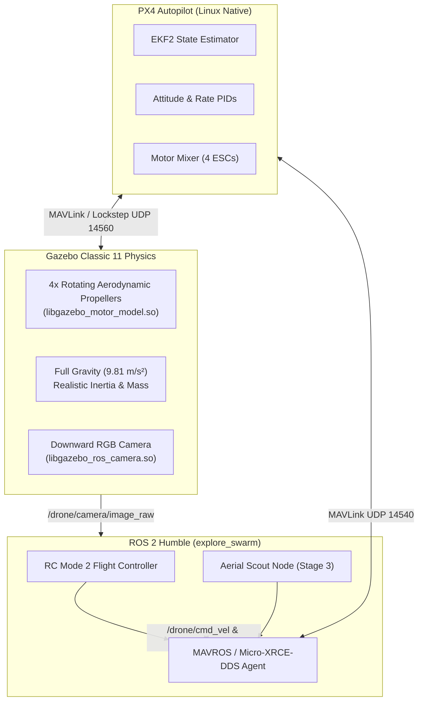

> **📍 Phase 3 › Stage 2B (PX4 Drone)** · [← Roadmap](../swarm_search_rescue_roadmap_v4.md) · [← P3 Runbook](P3-runbook.md) · Status: ✅ Completed & Verified

# Stage 2B: PX4 Autopilot SITL Integration & Realistic Flight
### Step-by-step engineering plan for full 6-DOF aerodynamic drone simulation with PX4 SITL, Gazebo Garden, and ROS 2 Humble

---

## ⚡ Quick Start: How to Run After Break

Run these 3 terminals in order:

```bash
# Terminal 1: Start ROS 2 DDS Bridge
MicroXRCEAgent udp4 -p 8888

# Terminal 2: Start PX4 SITL in Gazebo Garden
cd ~/PX4-Autopilot
make px4_sitl gz_x500

# Terminal 3: Start GTA-5 Flight Controller HUD
cd ~/swarm-search
source /opt/ros/humble/setup.bash
source install/setup.bash
ros2 run explore_swarm px4_teleop
```

* **Controls**: Click the HUD window $\rightarrow$ **`T`** takeoff to 2.5m, hold **`8` + `4`** for diagonal flight, **`W` + `8`** to climb while flying forward, release keys to auto-brake, and **`L`** to land!

---

## 1. Goal & Architectural Overview

In **Stage 2**, we established the lightweight kinematic drone baseline (simple red box quadrotor with intrinsic hover stability).

**Stage 2B** introduces the **high-fidelity aerial tier**: integrating the open-source **PX4 Autopilot** running in **Software-In-The-Loop (SITL)** with Gazebo Classic 11 and ROS 2 Humble.



### Why PX4 SITL?
1. **Authentic Aerodynamic Physics**: Quadrotor flight is driven by 4 independently spinning propeller blades generating aerodynamic lift and drag forces. To fly forward, the rear motors spin faster, tilting the airframe nose-down against $-9.81\,\text{m/s}^2$ gravity.
2. **Coordinated Banking**: Turns naturally bank into the wind without flat "cartoonish" sliding.
3. **Downward Camera Streaming**: Downward RGB camera mounted directly on the PX4 airframe pipes frames into standard ROS 2 `/drone/camera/image_raw`.
4. **Hardware Transferability**: Flight logic developed with PX4 SITL can deploy directly to a real physical drone equipped with a Pixhawk flight controller.
5. **Dual-Model Support**: The simple lightweight drone from Stage 2 is preserved as a fast fallback whenever low CPU usage is preferred.

---

## 2. Resource & Environment Specifications

| Parameter | Specification | Note |
|---|---|---|
| **Host System** | Ubuntu 22.04 LTS (WSL2) | Linux 5.15+ kernel |
| **GPU & VRAM** | NVIDIA RTX 3060 Laptop (6 GB VRAM) | Ample for Gazebo + camera rendering |
| **Disk Requirement** | ~4.5 GB for PX4 repo & build | Host has >900 GB available |
| **RAM Usage** | ~1.2 GB for PX4 SITL process | Host has 10 GB RAM + 32 GB swap |
| **PX4 Version** | **v1.14 (Stable Release)** | Native support for Gazebo Classic |
| **Gazebo Simulator** | **Gazebo Classic 11.10+** | Matches existing `turtlebot3_house.world` |
| **ROS Bridge** | **MAVROS (`ros-humble-mavros`)** | Pre-built apt package, zero compile overhead |
| **Cruise Altitude** | $z = 2.8\,\text{m}$ | Clears 2.5m interior house partition walls |

---

## 3. Step-by-Step Implementation Guide

---

### Step 1: Clone PX4 Autopilot (Stable v1.14)

Clone PX4 into the user's home directory (kept separate from `~/swarm-search` to keep the workspace clean):

```bash
cd ~
git clone https://github.com/PX4/PX4-Autopilot.git --recursive -b v1.14.3
```

---

### Step 2: Install PX4 Dependencies & Toolchain

Run the official PX4 Ubuntu setup script (skipping NuttX embedded ARM compilers since we only target SITL):

```bash
cd ~/PX4-Autopilot
bash ./Tools/setup/ubuntu.sh --no-nuttx
```

*Log out and log back in (or restart the terminal session) so group and path permissions take effect.*

---

### Step 3: Build & Verify Standalone PX4 SITL

Verify the build and standalone flight in Gazebo Classic:

```bash
cd ~/PX4-Autopilot
make px4_sitl gazebo-classic
```

* **What happens**: Gazebo Classic opens with a standard Iris quadrotor.
* **In the PX4 shell (`px4>`)**:
  ```text
  commander arm
  commander takeoff
  ```
  The 4 propellers will visibly spin up, lift off, and hold steady hover at 2.5m.
* To land and exit:
  ```text
  commander land
  ```
  Press `Ctrl+C` in the terminal to close.

---

### Step 4: Add Downward RGB Camera to PX4 Airframe

Create a custom PX4 airframe definition (`iris_downward_cam`) that includes the ROS 2 camera plugin:

1. Add camera macro to the Iris SDF model in `~/PX4-Autopilot/Tools/simulation/gazebo-classic/sitl_gazebo-classic/models/iris_downward_cam/model.sdf`:
```xml
<!-- Downward Facing Camera Sensor -->
<link name="camera_link">
  <pose>0 0 -0.05 0 1.570796 0</pose>
  <sensor name="camera" type="camera">
    <always_on>true</always_on>
    <update_rate>5.0</update_rate>
    <camera>
      <horizontal_fov>1.396263</horizontal_fov>
      <image>
        <width>320</width>
        <height>240</height>
        <format>R8G8B8</format>
      </image>
      <clip>
        <near>0.1</near>
        <far>15.0</far>
      </clip>
    </camera>
    <plugin name="camera_controller" filename="libgazebo_ros_camera.so">
      <ros>
        <namespace>drone</namespace>
        <remapping>image_raw:=camera/image_raw</remapping>
        <remapping>camera_info:=camera/camera_info</remapping>
      </ros>
      <camera_name>camera</camera_name>
      <frame_name>drone/camera_link</frame_name>
    </plugin>
  </sensor>
</link>
<joint name="camera_joint" type="fixed">
  <parent>base_link</parent>
  <child>camera_link</child>
</joint>
```

---

### Step 5: Install & Configure MAVROS for ROS 2 Humble

Install MAVROS from the official Ubuntu repositories:

```bash
sudo apt update
sudo apt install -y ros-humble-mavros ros-humble-mavros-extras
# Install GeographicLib datasets required by MAVROS GPS:
wget https://raw.githubusercontent.com/mavlink/mavros/master/mavros/scripts/install_geographiclib_datasets.sh
sudo bash ./install_geographiclib_datasets.sh
```

Create a launch file `launch/px4_mavros.launch.py` in `~/swarm-search`:
```python
from launch import LaunchDescription
from launch_ros.actions import Node

def generate_launch_description():
    return LaunchDescription([
        Node(
            package='mavros',
            executable='mavros_node',
            output='screen',
            parameters=[{
                'fcu_url': 'udp://:14540@127.0.0.1:14557',
                'gcs_url': '',
                'target_system_id': 1,
                'target_component_id': 1,
                'fcu_protocol': 'v2.0',
            }],
        ),
    ])
```

---

### Step 6: Spawn PX4 Drone into `turtlebot3_house.world`

Set the environment variables so PX4 uses our custom house world and models:

```bash
cd ~/PX4-Autopilot
export GAZEBO_MODEL_PATH=$GAZEBO_MODEL_PATH:$HOME/swarm-search/models
export GAZEBO_RESOURCE_PATH=$GAZEBO_RESOURCE_PATH:$HOME/swarm-search/worlds
export PX4_SIM_MODEL=iris_downward_cam

# Launch PX4 SITL in turtlebot3_house at z = 2.8m:
PX4_HOME_LAT=47.397742 PX4_HOME_LON=8.545594 PX4_HOME_ALT=2.8 \
make px4_sitl gazebo-classic__turtlebot3_house
```

---

### Step 7: Flight Control via ROS 2

With MAVROS running, the drone can be controlled via standard ROS 2 topics:

* **Velocity Setpoints**: Publish to `/mavros/setpoint_velocity/cmd_vel_unstamped`
* **Arming Service**: Call `/mavros/cmd/arming`
* **Mode Setting**: Call `/mavros/set_mode` (e.g. `OFFBOARD`)
* **Camera Stream**: View downward video on `/drone/camera/image_raw`

---

## 4. Stage 2B Verification Checklist

- [x] Clone `PX4-Autopilot` (v1.14.3) into `~/PX4-Autopilot`
- [x] Run `ubuntu.sh --no-nuttx` setup script and verify dependencies
- [x] Build and verify standalone `make px4_sitl gz_x500` in Gazebo Garden
- [x] Install `Micro-XRCE-DDS-Agent` and build `px4_msgs` in `~/swarm-search/src/px4_msgs`
- [x] Verify live odometry on `/fmu/out/vehicle_odometry`
- [x] Implement GTA-5 direct hardware multi-key flight controller ([`px4_teleop.py`](file:///home/pruth/swarm-search/src/explore_swarm/explore_swarm/px4_teleop.py)) via Pygame (SDL2)
- [x] Verify independent axis locking: simultaneous `8` + `4` diagonal flight, `W` + `8` climb + forward flight, and immediate position hold on key release
- [ ] Mount downward camera plugin on PX4 airframe (`x500_depth` or downward camera macro)
- [ ] Spawn PX4 drone in `turtlebot3_house.world` alongside 3 TurtleBots (Stage 3)

---

## 5. Fallback Strategy (Model Switching)

| Use Case | Recommended Command | Key Benefits |
|---|---|---|
| **High-Fidelity Flight** | `ros2 launch explore_swarm px4_drone.launch.py` | Full motor aerodynamics, realistic tilt, Pixhawk flight stack |
| **Lightweight Baseline** | `ros2 launch explore_swarm drone_spawn.launch.py` | Minimal CPU load, zero external compilation, instant start |
