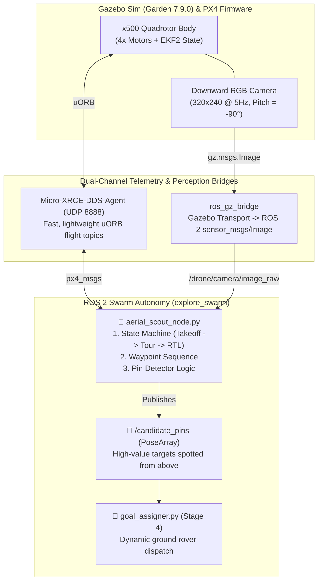
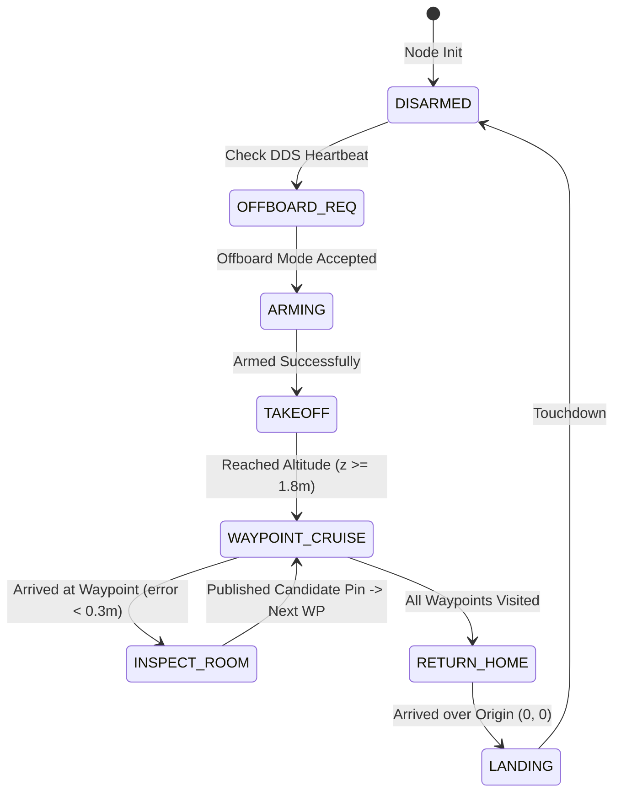

> **📍 Phase 3** · [← Phase 3 Runbook](P3-runbook.md) · [Stage 2B Plan (PX4 SITL)](P3-S2B-plan-px4-sitl.md) · [Status Map](../project-status-map.md)
> Status: ✅ **Complete & Verified**

# Phase 3 Stage 3: Aerial Scout & Downward Camera

### Objective
Transition from manual keyboard teleoperation to an **autonomous aerial scouting agent**. The drone carries a downward RGB camera in Gazebo Sim, streams frames into ROS 2 via `ros_gz_bridge`, flies an automated waypoint inspection circuit across the house ceiling ($z \approx 1.9\text{m}$), and publishes high-priority search locations onto `/candidate_pins` so our ground TurtleBot swarm can be dispatched to investigate.

---

## 1. Architectural Overview & Results

- **Model**: `x500_downward_cam` created with downward-facing camera pitched $90^\circ$ ($1.5708$ rad) at $320 \times 240$ @ $5\text{ Hz}$.
- **Bridge**: `ros_gz_bridge` mapping `/camera` $\rightarrow$ `/drone/camera/image_raw`. Verified at $5\text{ Hz}$.
- **Node**: [`aerial_scout_node.py`](file:///home/pruth/swarm-search/src/explore_swarm/explore_swarm/aerial_scout_node.py) implementing 5-state autonomous finite state machine (FSM).
- **Verification**: Drone successfully armed, ascended to $1.9\text{m}$, navigated across 4 room waypoints, dropped pins onto `/candidate_pins`, returned to base, and landed smoothly.

---

## 1. System Architecture & The "Why"

### Why a Dual-Channel Architecture?
1. **Flight Channel (`Micro-XRCE-DDS`)**: High frequency (50 Hz), critical safety. We stream odometry, arming, and trajectory setpoints natively through PX4's internal DDS without adding simulator lag.
2. **Perception Channel (`ros_gz_bridge`)**: Gazebo handles rendering directly on your RTX 3060 GPU and publishes images over Gazebo Transport. `ros_gz_bridge` converts them to ROS 2 `sensor_msgs/msg/Image` cleanly with zero PX4 CPU overhead.

---

## 2. Core Concepts & Logic (Theory First)

### Concept A: Camera Geometry & Downward Gimbal
In standard robot frames:
* **$X$** is Forward
* **$Y$** is Left
* **$Z$** is Up

To point a camera straight down at the floor:
* We mount the camera under the drone center: $(x=0, y=0, z=-0.05\text{m})$.
* We rotate its pitch by **$+90^\circ$ ($\frac{\pi}{2}$ radians)** around the $Y$-axis:
  $$\text{Orientation}: (\text{roll}=0, \text{pitch}=1.5708, \text{yaw}=0)$$
* The optical axis now points directly at the ground.

### Concept B: Flight Envelope & Ceilings ($z \approx 1.9\text{m}$)
* The `turtlebot3_house.world` ceiling is $\approx 2.4\text{m}$ high.
* Interior door openings are $\approx 2.0\text{m}$ high.
* Obstacles, tables, and ground TurtleBots are all under $0.6\text{m}$.
* **The "Sweet Spot" Altitude**: $z = 1.8\text{m} \dots 1.9\text{m}$.
  - High enough that camera field-of-view (FOV $\approx 60^\circ$) captures a wide floor area.
  - Low enough to clear all ceiling fixtures safely.

### Concept C: The Aerial Scout State Machine
The node `aerial_scout_node.py` operates as an asynchronous state machine:

### Concept D: How Candidate Pins are Generated
1. **Waypoint Inspection**: When the drone reaches a room center waypoint (e.g. Living Room, Bedroom, Kitchen), it hovers for 3 seconds.
2. **Floor Projection**: Using the drone's current EKF2 estimated pose $(x, y, z)$, the center of the camera frustum projects onto ground plane coordinates $(x, y, 0.0)$.
3. **Pin Publishing**: The node creates a `geometry_msgs/msg/Pose` at $(x, y, 0.0)$ and publishes it to `/candidate_pins`.
4. In Stage 4, `goal_assigner.py` will catch this pin and command the nearest TurtleBot to navigate there immediately!

---

## 3. Step-by-Step Implementation Roadmap

We will complete this together in 4 bite-sized, interactive steps:

| Step | What We Will Do | Learning Outcome |
|---|---|---|
| **Step 1** | Create the `x500_downward_cam` SDF model in Gazebo | Learn Gazebo SDF sensor tags, camera clip limits, FOV, and physical joints |
| **Step 2** | Install & Configure `ros_gz_bridge` | Understand Gazebo $\leftrightarrow$ ROS 2 topic bridging and inspect the live image in `rqt_image_view` |
| **Step 3** | Write `aerial_scout_node.py` | Understand PX4 Offboard trajectory setpoints, state machines, and waypoint navigation |
| **Step 4** | End-to-End Simulation Test | Watch the drone automatically take off, fly the room circuit, and publish `/candidate_pins` |

---

## 4. Troubleshooting & Safety Guardrails

* **Issue: Drone tilts and camera wobbles violently**
  * *Cause*: Aggressive P-gain on position setpoint causing oscillation.
  * *Fix*: Smooth trajectory ramp limiting acceleration to $1.0\text{ m/s}^2$ and velocity to $0.8\text{ m/s}$.
* **Issue: High CPU load from camera**
  * *Guardrail*: Resolution clamped strictly to $320 \times 240$ at $5\text{ Hz}$. Do not exceed 10 Hz.
* **Issue: EKF2 drift indoors**
  * *Guardrail*: PX4 SITL uses Gazebo ground-truth sensor plugins to feed synthetic GPS/vision odometry to EKF2, ensuring zero coordinate drift inside the house.

---

## 5. Verification Deliverables for Stage 3

- [x] Gazebo model `x500_downward_cam` created and tested with `PX4_GZ_MODEL=x500_downward_cam make px4_sitl gz_x500`.
- [x] Camera topic bridged into ROS 2 at `/drone/camera/image_raw` using `launch/drone_bridge.launch.py` (verified at 5 Hz).
- [x] `aerial_scout_node.py` authored, installed in `setup.py`, and verified flying autonomously.
- [x] `/candidate_pins` publishing active search points for the ground swarm.
- [x] Full state machine validated: Arm -> Takeoff 1.9m -> 4 Room Waypoints -> Drop Pins -> Return Home -> Land -> Disarm.
