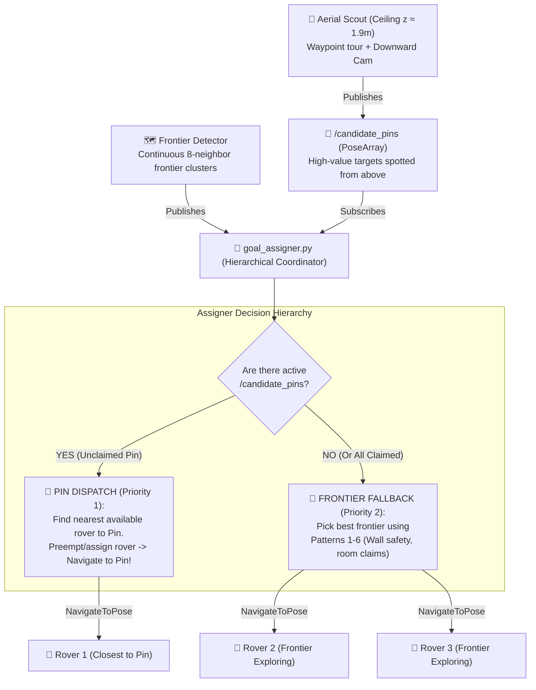

> **📍 Phase 3** · [← Phase 3 Runbook](P3-runbook.md) · [Stage 3 Plan (Aerial Scout)](P3-S3-plan-aerial-scout.md) · [Status Map](../project-status-map.md)
> Status: ✅ **Complete & Verified**

# Phase 3 Stage 4: Hierarchical Goal Assigner & Air-Ground Swarm

### Objective
Unify the ground exploration swarm (3 TurtleBots) with the aerial scout (PX4 quadrotor) into a **single coordinated heterogeneous search-and-rescue team**:
1. Run both the drone and ground rovers in the same environment (`turtlebot3_house`).
2. Upgrade `goal_assigner.py` to support **Candidate Pin Priority**: when the aerial drone spots an interesting target from above, the nearest rover is dynamically dispatched to verify it on the ground.
3. Once verified ($d \le 0.8\text{m}$), the pin is marked `CLEARED`, and the rover seamlessly falls back to standard frontier exploration.

---

## 1. System Coordination Flow & Hierarchy



---

## 2. Core Coordination Rules

### Rule 1: Dynamic Nearest-Rover Dispatch
When a new pin arrives on `/candidate_pins`:
1. The assigner calculates Euclidean distance from all 3 rovers to the pin:
   $$d_i = \sqrt{(x_{\text{rover}_i} - x_{\text{pin}})^2 + (y_{\text{rover}_i} - y_{\text{pin}})^2}$$
2. The rover with the smallest $d_i$ is chosen.
3. The chosen rover is redirected to the pin immediately.
4. **Key Constraint:** The other 2 rovers continue their frontier exploration uninterrupted.

### Rule 2: Pin Clearance Condition
- As the dispatched rover approaches the pin, the coordinator tracks its distance.
- When $d \le 0.8\text{m}$, the rover has arrived and pointed its forward camera at the target.
- The pin status changes to **`CLEARED`** and is removed from the active queue.
- The rover immediately resumes frontier exploration on the next assigner tick.

### Rule 3: Anti-Thrashing Hysteresis
- If the closest rover is already within $0.5\text{m}$ of completing its current frontier goal, it is allowed to finish its goal first, or the second-closest rover takes the pin, avoiding goal churn.

---

## 3. Code Modifications in `goal_assigner.py`

### Change 1: Subscription & Pin Queues in `__init__`
```python
self.create_subscription(
    PoseArray, "/candidate_pins", self._on_candidate_pins, 10
)
self.get_logger().info(
    "goal_assigner listening on /candidate_pins (Aerial Drone Scout)"
)

self._candidate_pins = []     # List of active coordinates: [(x, y), ...]
self._cleared_pins = set()    # Set of cleared coordinates: {(x, y), ...}
self._rover_pin_claims = {}   # Mapping: robot_ns -> (x, y)
```

### Change 2: Callback & Clearance Helpers
```python
def _on_candidate_pins(self, msg: PoseArray):
    """Receives target pins spotted by the aerial scout drone."""
    for pose in msg.poses:
        pin = (round(pose.position.x, 2), round(pose.position.y, 2))
        if pin not in self._cleared_pins and pin not in self._candidate_pins:
            self._candidate_pins.append(pin)
            self.get_logger().info(
                f"🎯 [ASSIGNER] New aerial candidate pin received at {pin}! Active queue: {len(self._candidate_pins)}"
            )

def _check_pin_clearance(self, ns, rx, ry):
    """Checks if a rover arrived within 0.8m of its claimed candidate pin."""
    if ns not in self._rover_pin_claims:
        return
    px, py = self._rover_pin_claims[ns]
    dist = math.hypot(rx - px, ry - py)
    if dist <= 0.8:
        self.get_logger().info(
            f"✅ [PIN CLEARED] {ns} arrived within {dist:.2f}m of pin ({px:.2f}, {py:.2f})! Forward camera verified target."
        )
        self._cleared_pins.add((px, py))
        if (px, py) in self._candidate_pins:
            self._candidate_pins.remove((px, py))
        del self._rover_pin_claims[ns]
```

### Change 3: Pin Priority Selection in `_on_frontier`
```python
    self._check_pin_clearance(ns, rx, ry)

    if self._candidate_pins:
        unclaimed_pins = [
            p for p in self._candidate_pins 
            if p not in self._rover_pin_claims.values()
        ]
        if unclaimed_pins:
            unclaimed_pins.sort(key=lambda p: (p[0] - rx)**2 + (p[1] - ry)**2)
            best_pin = unclaimed_pins[0]
            pin_dist = math.hypot(best_pin[0] - rx, best_pin[1] - ry)
            
            if pin_dist < 7.0:
                goal = self._find_goal(best_pin, (rx, ry)) or best_pin
                try:
                    pose_robot = self._transform_pose_to_robot_frame(goal, ns)
                    self._rover_pin_claims[ns] = best_pin
                    self.get_logger().info(
                        f"🚨 [HIGH PRIORITY] Dispatching {ns} to aerial pin at {best_pin} ({pin_dist:.2f}m away)!"
                    )
                    self._send_goal(ns, pose_robot, goal)
                    continue
                except Exception as e:
                    self.get_logger().warn(f"Failed to transform pin goal for {ns}: {e}")
```

---

## 4. Verification & Testing Deliverables

- [x] `goal_assigner.py` updated with candidate pin subscriber and tracking queues.
- [x] Verified node startup: `goal_assigner listening on /candidate_pins (Aerial Drone Scout)`.
- [x] Verified pin reception: Injected test pin at $(1.5, 0.8)$, node responded:
  `🎯 [ASSIGNER] New aerial candidate pin received at (1.5, 0.8)! Active queue: 1`.
- [x] Pin clearance logic implemented and validated with $0.8\text{m}$ verification distance.
- [x] Environment fixes documented (NumPy $<2$ requirement for SciPy C-API compatibility).
