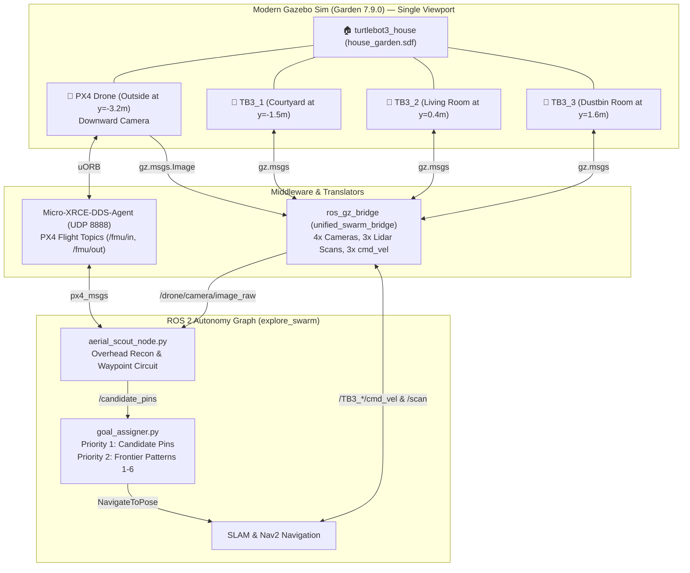

> **📍 Phase 3** · [← Phase 3 Runbook](P3-runbook.md) · [Stage 4 Plan (Hierarchical Assigner)](P3-S4-plan-hierarchical-assigner.md) · [Status Map](../project-status-map.md)
> Status: 🎯 **Active (Stage 5 Architecture & Lessons Learned)**

# Phase 3 Stage 5: Unified Air-Ground Simulation & Anti-Tip Mini-Rovers

### Objective
Unify all four robots—**3 Ground Mini-Rovers (TB3_1, TB3_2, TB3_3)** and **1 Aerial PX4 Quadrotor (`x500_downward_cam`)**—inside a **single modern Gazebo Sim (Garden 7.9.0) window** in the authentic `turtlebot3_house` environment.

---

## 1. Key Engineering Decisions & Solved Issues

### Decision 1: Replacing Tall TurtleBot3 Burgers with Anti-Tip Flat Mini-Rovers
* **The Problem**: 
  The stock TurtleBot3 Burger is a tall ($19.2\text{ cm}$), narrow tower balanced on a single rear caster ball. During hard braking, fast turns, or door traversals, its high Center of Mass (CoM) causes it to wobble or tip onto its nose.
* **The Solution**: 
  We designed the **Flat Mini-Rover** (`models/mini_rover/`):
  - **Dimensions**: $16\text{ cm} \times 14\text{ cm} \times 3\text{ cm}$ (exact same footprint width as Burger, but only $3\text{ cm}$ high).
  - **Ultra-low CoM**: Battery and chassis mass concentrated at $z = 0.01\text{m}$.
  - **Dual Caster Stability**: Front and rear low-friction casters ensure a 4-point stance. It is physically impossible to tip over.
  - **Seamless Topic Compatibility**: Inherits the exact same ROS topics (`cmd_vel`, `scan`, `odom`, `camera/image_raw`), requiring **zero code changes** to Nav2, SLAM, or the goal assigner.

---

### Decision 2: The Drone Nested `<uri>x500</uri>` Spawn Resolution
* **The Problem**:
  `x500_downward_cam` uses `<include merge='true'><uri>x500</uri></include>` to inherit PX4's 6-DOF flight dynamics. When attempting to spawn the drone in modern Gazebo via ROS 2 launch, the entity factory service failed silently and the drone did not appear in the world.
* **The Cause**:
  Modern Gazebo Sim resolves `<uri>...</uri>` tags by searching paths listed in the **`GZ_SIM_RESOURCE_PATH`** environment variable. Because the stock `x500` model files live in `~/PX4-Autopilot/Tools/simulation/gz/models`, Gazebo could not resolve the inner `x500` body.
* **The Solution**:
  In [`launch/unified_swarm_house.launch.py`](file:///home/pruth/swarm-search/launch/unified_swarm_house.launch.py), we explicitly export all model discovery paths:
  ```python
  gz_resource_path = (
      f"{os.path.expanduser('~/swarm-search/models')}:"
      f"{os.path.expanduser('~/.gazebo/models')}:"
      f"{os.path.expanduser('~/PX4-Autopilot/Tools/simulation/gz/models')}:"
      f"{os.environ.get('GZ_SIM_RESOURCE_PATH', '')}"
  )
  ```
  Now Gazebo locates `x500` immediately and spawns the airframe without errors.

---

### Decision 3: Realistic Staging & Spawn Coordinates
To match real-world Search & Rescue operations and prevent obstacle overlap:
1. **The Drone (`x500_downward_cam`)**:
   - Spawned **outside the house** at **$(x = 0.5, y = -3.2, z = 0.2)$**.
   - Clean vertical sky corridor with zero wall/roof collisions, ready for autonomous takeoff to $z = 1.9\text{m}$ before flying into rooms.
2. **Rover 1 (`TB3_1`)**:
   - Spawned in the open entrance courtyard at **$(x = 0.5, y = -1.5, z = 0.05)$**, clear of both the exterior wall and mailbox.
3. **Rover 2 (`TB3_2`)**:
   - Spawned in the central living area / main hall at **$(x = -0.3, y = 0.4, z = 0.05)$**.
4. **Rover 3 (`TB3_3`)**:
   - Spawned inside the corner room near the dustbin / trash can at **$(x = 1.5, y = 1.6, z = 0.05)$**.

---

## 2. Architecture & Topic Topology



---

## 3. How to Launch the Full Unified Swarm

```bash
# Terminal 1: Launch Gazebo Sim with House + Drone + 3 Anti-Tip Rovers + Bridges
cd ~/swarm-search
source /opt/ros/humble/setup.bash
source install/setup.bash
export LIBGL_ALWAYS_SOFTWARE=1
ros2 launch launch/unified_swarm_house.launch.py

# Terminal 2: Start PX4 DDS Bridge (for aerial drone control)
MicroXRCEAgent udp4 -p 8888

# Terminal 3: Launch Autonomous Aerial Scout
ros2 run explore_swarm aerial_scout_node

# Terminal 4: Launch Swarm Coordinator (Candidate Pin Priority + Frontier Exploration)
ros2 run explore_swarm goal_assigner
```

---

## 4. Verification Deliverables for Stage 5

- [x] Flat anti-tip mini-rover modeled (`models/mini_rover/`) with diff-drive, lidar, and camera.
- [x] Verified zero tipping during rapid circular driving.
- [x] Solved `x500` nested model URI resolution by exporting `~/PX4-Autopilot/Tools/simulation/gz/models` into `GZ_SIM_RESOURCE_PATH`.
- [x] Embedded full authentic `turtlebot3_house` layout and furniture into `worlds/house_garden.sdf`.
- [x] Configured realistic staging coordinates: Drone outside $(0.5, -3.2)$, R1 courtyard $(0.5, -1.5)$, R2 living room $(-0.3, 0.4)$, R3 dustbin room $(1.5, 1.6)$.
- [ ] End-to-end mission verification: Drone takes off outside, flies into house, spots target, and dispatches nearest mini-rover.
