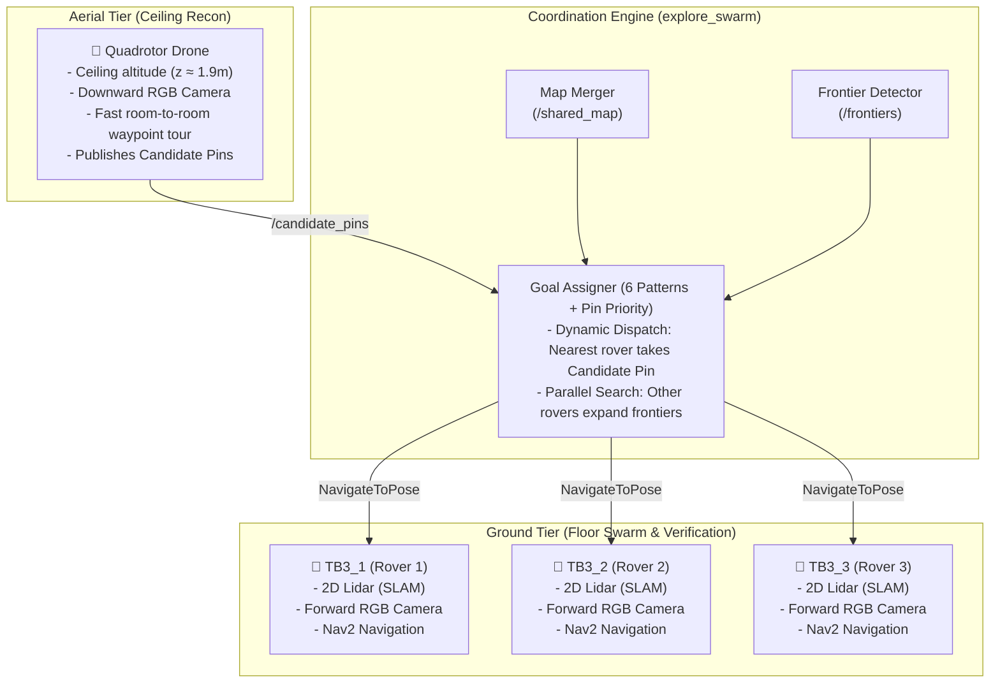

> **📍 Phase 3** · [← Roadmap](../swarm_search_rescue_roadmap_v4.md) · [Project Status](../project-status-map.md) · Status: 🚀 Kick-off

# Phase 3 Runbook — Heterogeneous Air-Ground Swarm
### 3 Ground TurtleBots (Lidar + Camera) + 1 Aerial Drone (Top-Down Scout)

---

## ⚡ Quick-Start: How to Launch After Break

### PX4 Drone Flight & GTA-5 Teleop (Stage 2B)

Run these 3 terminals in order:

```bash
# Terminal 1: ROS 2 DDS Bridge
MicroXRCEAgent udp4 -p 8888

# Terminal 2: PX4 in Gazebo
cd ~/PX4-Autopilot
make px4_sitl gz_x500

# Terminal 3: GTA-5 Game-Style Flight Controller
cd ~/swarm-search
source /opt/ros/humble/setup.bash
source install/setup.bash
ros2 run explore_swarm px4_teleop
```

* **Controls**: Click HUD window $\rightarrow$ **`T`** takeoff to 2.5m, hold **`8` + `4`** for diagonal flight, **`W` + `8`** to climb & fly forward, release keys to auto-brake, and **`L`** to land!

---

## 1. System Vision & Architecture (Option 2: Symmetric Ground + Aerial Scout)

Phase 3 transitions the project from a ground-only mapping team into a **heterogeneous air-ground search and rescue swarm**.



### Why this architecture?
1. **Redundancy (No Single Point of Failure)**: All 3 ground rovers carry cameras. If one robot gets stuck or blocked by a door, any of the remaining rovers can verify the aerial candidate pin.
2. **Speed (Minimizing Time-to-Find)**: The aerial drone covers large distances across the ceiling in seconds. The coordinator immediately dispatches the closest rover to the candidate pin while teammates continue expanding the map.
3. **Compute Efficiency**: Cameras run at **320×240 or 640×480 at 5 Hz**, keeping GPU VRAM well within the 6 GB budget on WSL2.

---

## 2. Resource & Hardware Budget (WSL2 + RTX 3060 6GB)

| Component | Resolution / Rate | CPU/GPU Load | Strategy |
|---|---|---|---|
| **Gazebo Classic 11** | Physics 1000 Hz / Real-time factor ~0.7-1.0 | 4 CPU cores | Keep collision meshes simple. |
| **Drone Camera** | 320×240 @ 5–10 Hz (downward) | ~150 MB VRAM | Low-rate off-screen rendering. |
| **3× Rover Cameras** | 320×240 @ 5 Hz (forward) | ~300 MB VRAM total | Low resolution avoids bus bottlenecks. |
| **Lidar (3× 2D)** | 360 beams @ 5 Hz | Minimal | Existing Phase 2 configuration. |
| **SLAM & Nav2** | 3 instances | ~2 CPU cores | Reused from Phase 2. |

---

## 3. Phase 3 Implementation Stages

Phase 3 is divided into 5 sequential stages:


---

### Stage 1: Add Forward RGB Cameras to TurtleBot3 Burgers
> 📖 Detailed step-by-step implementation guide: [P3-S1-plan-add-cameras.md](P3-S1-plan-add-cameras.md)

Each TurtleBot3 Burger needs a lightweight Gazebo camera plugin attached to its URDF/SDF.

#### 1.1 Camera Specs
* **Topic**: `/<robot_ns>/camera/image_raw`
* **Info Topic**: `/<robot_ns>/camera/camera_info`
* **Frame**: `<robot_ns>/camera_link`
* **Resolution**: `320 x 240` (keeps rendering fast and lightweight)
* **Update rate**: `5.0 Hz`

#### 1.2 Plugin Definition (Gazebo ROS Camera)
In the TurtleBot SDF or URDF:
```xml
<sensor name="camera" type="camera">
  <always_on>true</always_on>
  <update_rate>5.0</update_rate>
  <camera>
    <horizontal_fov>1.085</horizontal_fov>
    <image>
      <width>320</width>
      <height>240</height>
      <format>R8G8B8</format>
    </image>
    <clip>
      <near>0.05</near>
      <far>8.0</far>
    </clip>
  </camera>
  <plugin name="camera_controller" filename="libgazebo_ros_camera.so">
    <ros>
      <namespace>/TB3_1</namespace>
      <remapping>image_raw:=camera/image_raw</remapping>
      <remapping>camera_info:=camera/camera_info</remapping>
    </ros>
    <camera_name>camera</camera_name>
    <frame_name>TB3_1/camera_link</frame_name>
  </plugin>
</sensor>
```

---

### Stage 2: Gazebo Quadrotor Drone Model & Spawn
> 📖 Detailed step-by-step implementation guide: [P3-S2-plan-drone-bringup.md](P3-S2-plan-drone-bringup.md)

#### 2.1 The Drone Platform
* **Model**: Lightweight quadrotor (e.g., standard Gazebo quadrotor plugin or `sjtu_drone` / Hector model).
* **Control Interface**: Velocity-based flight (`/drone/cmd_vel`, `geometry_msgs/msg/Twist`).
* **Fixed Flight Altitude**: $z = 1.8\text{m}$ to $2.0\text{m}$ (beneath the ceiling of `turtlebot3_house.world`, safely flying above furniture and rovers).
* **Sensor**: Downward-facing camera (`/drone/camera/image_raw`).

#### 2.2 Drone Topics & TFs
| Topic / TF | Type | Description |
|---|---|---|
| `/drone/cmd_vel` | `geometry_msgs/msg/Twist` | Velocity commands ($v_x, v_y, v_z, \omega_z$) |
| `/drone/odom` | `nav_msgs/msg/Odometry` | Drone altitude & position estimation |
| `/drone/camera/image_raw` | `sensor_msgs/msg/Image` | Downward view of the house |
| TF: `shared_map` → `drone/base_link` | Transform | Spatial alignment with the team map |

---

### Stage 2B: PX4 Autopilot SITL Integration & Realistic Flight — ✅ Complete
> 📖 Detailed step-by-step implementation guide: [P3-S2B-plan-px4-sitl.md](P3-S2B-plan-px4-sitl.md)

* **Autopilot & Simulator**: Open-source PX4 Autopilot SITL v1.14 running on modern Gazebo Garden (`gz sim` 7.9.0 with `gz_x500`).
* **Flight Dynamics**: Authentic 6-DOF propeller aerodynamics, motor mixing, gravity, pitch tilt, roll banking, and EKF2 state estimation.
* **ROS 2 Integration**: `Micro-XRCE-DDS-Agent` running on UDP 8888 bridging uORB topics directly into standard ROS 2 `px4_msgs`.
* **GTA-5 Style Flight Controller ([`px4_teleop.py`](file:///home/pruth/swarm-search/src/explore_swarm/explore_swarm/px4_teleop.py))**:
  - Direct hardware key scanning via Pygame (SDL2).
  - True multi-key combinations: hold `8` + `4` (diagonal), `W` + `8` (climb + forward), `A` + `8` (banking turn).
  - Independent axis position braking: releasing keys locks horizontal or vertical position immediately.
  - Auto-takeoff (`T` to 2.5m) and smooth land (`L`).

---

### Stage 3: Aerial Scout Node (`aerial_scout_node.py`) & Downward Camera — 🎯 Next Up (Post-Break)

Create a dedicated ROS 2 node in `src/explore_swarm/explore_swarm/aerial_scout_node.py` (or a dedicated package).

#### 3.1 Responsibilities
1. **Takeoff & Altitude Hold**: Commands $v_z$ until altitude reaches $1.9\text{m}$, then holds with PID or closed-loop position control.
2. **Room Tour (Waypoints)**: Follows a predefined or frontier-guided sequence of room waypoints across the house layout.
3. **Candidate Pin Generation**:
   * As it sweeps over a room, it identifies high-interest regions (e.g., center of large unmapped spaces or visual candidates).
   * Publishes the location onto `/candidate_pins` (`geometry_msgs/msg/PoseArray`).

---

### Stage 4: Hierarchical Goal Assigner Upgrade (`goal_assigner.py`)

Upgrade [`goal_assigner.py`](file:///home/pruth/swarm-search/src/explore_swarm/explore_swarm/goal_assigner.py) to support **Candidate Pin Priority**:

```python
# Pseudocode logic in goal_assigner.py
def _select_goal_for_robot(self, robot_name):
    # 1. First priority: Are there active drone candidate pins?
    if self._candidate_pins:
        nearest_pin = self._find_best_candidate_pin(robot_name)
        if nearest_pin and not self._is_pin_claimed_by_other(nearest_pin, robot_name):
            self._claim_pin(nearest_pin, robot_name)
            return nearest_pin

    # 2. Second priority: Standard frontier exploration (Patterns 1–6)
    return self._find_best_frontier(robot_name)
```

#### Key Rules:
* **Pin Clearance Threshold**: When any ground rover arrives within $0.8\text{m}$ of a candidate pin, the pin is marked `CONFIRMED / CLEARED` and removed from the active pin set.
* **Non-blocking Teammates**: If Robot 1 takes a candidate pin in Room A, Robots 2 and 3 do not wait—they continue exploring local frontiers in Rooms B and C.

---

## 4. Verification & Testing Workflow

### Step-by-Step Test Sequence

1. **Test 1 — Camera Streams**:
   * Spawn 3 TurtleBots with camera sensors enabled.
   * Verify all 3 image feeds in RViz: `/TB3_1/camera/image_raw`, `/TB3_2/camera/image_raw`, `/TB3_3/camera/image_raw`.
   * Confirm simulation RTF (Real-Time Factor) stays $\ge 0.75$.

2. **Test 2 — Drone Flight**:
   * Spawn quadrotor at `(0, 0, 0.1)`.
   * Send takeoff command to $z = 1.9\text{m}$.
   * Verify altitude hold stability and downward camera view.

3. **Test 3 — Candidate Pin Dispatch**:
   * Publish a synthetic pin: `ros2 topic pub --once /candidate_pins ...`
   * Observe `goal_assigner`: verify the closest TurtleBot immediately preempts its frontier goal to navigate to the pin.

4. **Test 4 — Full Coordinated Sweep**:
   * Drone sweeps waypoints overhead.
   * Ground swarm follows pins and frontiers concurrently.

---

## 5. Common Pitfalls & Solutions

* **Pitfall 1: Drone hits house doorframes or ceiling**
  * *Cause*: House world ceiling is roughly $2.4\text{m}$ high, but interior doorways have top frames.
  * *Fix*: Keep drone cruising strictly inside open rooms or elevate flight above wall heights if roof is removed, or stay at $1.8\text{m}$ to clear ceiling fixtures.
* **Pitfall 2: High CPU / Lag from 4 cameras**
  * *Cause*: Gazebo rendering 4 full-rate 30 FPS cameras.
  * *Fix*: Enforce `<update_rate>5.0</update_rate>` and `<width>320</width><height>240</height>` across all camera plugins.
* **Pitfall 3: Goal thrashing between Pins and Frontiers**
  * *Cause*: Drone publishes a pin right when a rover is 0.2m away from a frontier goal.
  * *Fix*: Apply the same 10s hysteresis from Pattern 6 (in-flight redirection) so rovers do not abort nearly-completed goals.

---

## 6. Phase 3 Deliverables Checklist

- [x] Forward RGB camera plugin active on `TB3_1`, `TB3_2`, `TB3_3` (Verified in rqt & RViz)
- [ ] Gazebo quadrotor drone model with altitude control & downward camera
- [ ] Drone spawn launch integration
- [ ] `aerial_scout_node.py` waypoint follower & `/candidate_pins` publisher
- [ ] Hierarchical task allocation in `goal_assigner.py` (Pin priority + fallback to frontiers)
- [ ] Multi-agent air-ground exploration demo recorded

