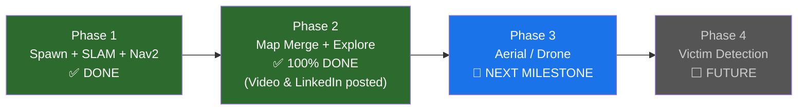
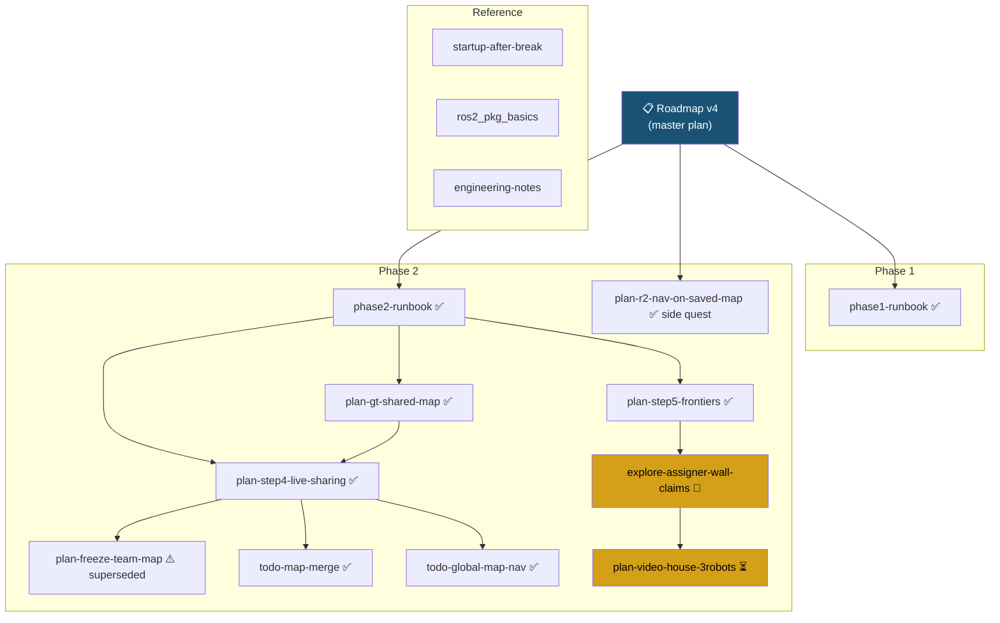

# 🗺️ Swarm Search — Project Status & Doc Map

> Your main roadmap is [swarm_search_rescue_roadmap_v4.md](file:///home/pruth/swarm-search/docs/swarm_search_rescue_roadmap_v4.md). Everything else supports specific topics from it.

---

## Where You Are Right Now

**Phase 2 is fully complete.** All 6 assigner patterns, Nav2/SLAM tuning, and stuck-recovery watchdogs are implemented, the 3-robot house exploration video was recorded, the README showcase was published, and the milestone was posted on LinkedIn. **You are now at the threshold of Phase 3 (Aerial Drone Integration).**

---

## Phase 1 — ✅ Fully Complete

| Step | What | Status |
|------|------|--------|
| Step 1 | Multi-robot spawn (3 TurtleBots, namespaced) | ✅ Done |
| Step 2 | Per-robot SLAM (`slam_toolbox`) | ✅ Done |
| Step 3 | Per-robot Nav2 | ✅ Done |

📄 **Doc:** [P1-runbook.md](file:///home/pruth/swarm-search/docs/phase1/P1-runbook.md) — step-by-step guide, complete

---

## Phase 2 — ✅ 100% Complete & Published

| Step | What | Status |
|------|------|--------|
| Step 4 | Map merge with GT TFs → `/shared_map` | ✅ Done |
| Step 5 | Frontier detection + goal assignment → autonomous explore | ✅ Done |
| Patterns | Wall-safe goals, room claims, escape goals, TF freeze, relay, watchdog, redirection | ✅ Done (all 6 patterns) |
| House Video | 3-robot house demo recording + LinkedIn post | ✅ Done & Published |

### Step 4 docs (all done):

| Doc | Purpose | Status |
|-----|---------|--------|
| [P2-S1-plan-gt-shared-map.md](file:///home/pruth/swarm-search/docs/phase2/P2-S1-plan-gt-shared-map.md) | GT TF design for map alignment | ✅ Done & implemented |
| [P2-S4-plan-live-sharing.md](file:///home/pruth/swarm-search/docs/phase2/P2-S4-plan-live-sharing.md) | Live map sharing pipeline | ✅ Done |
| [P2-S2-plan-freeze-team-map.md](file:///home/pruth/swarm-search/docs/phase2/P2-S2-plan-freeze-team-map.md) | Snapshot shared map for stable costmap | ⚠️ Superseded by `shared_map_relay.py` |
| [P2-S0-todo-map-merge-v1.md](file:///home/pruth/swarm-search/docs/phase2/P2-S0-todo-map-merge-v1.md) | Merge task checklist | ✅ Done |
| [P2-checklist.md](file:///home/pruth/swarm-search/docs/phase2/P2-checklist.md) | Nav2-on-shared-map checklist | ✅ Done |

### Step 5 docs (all patterns & recording complete):

| Doc | Purpose | Status |
|-----|---------|--------|
| [P2-S5-plan-frontiers.md](file:///home/pruth/swarm-search/docs/phase2/P2-S5-plan-frontiers.md) | Frontier detection + assignment design | ✅ Done |
| [P2-S5-patterns-wall-claims.md](file:///home/pruth/swarm-search/docs/phase2/P2-S5-patterns-wall-claims.md) | Pattern fixes (1 through 6) for goal assigner | ✅ Done & validated |
| [P2-video-plan-house-3robots.md](file:///home/pruth/swarm-search/docs/phase2/P2-video-plan-house-3robots.md) | House video plan + checklist | ✅ Done & posted |

### Side quest (done, not on critical path):

| Doc | Purpose | Status |
|-----|---------|--------|
| [P2-S3-plan-r2-nav-on-saved-map.md](file:///home/pruth/swarm-search/docs/phase2/P2-S3-plan-r2-nav-on-saved-map.md) | Experiment: nav on pre-saved map | ✅ Done (side experiment) |
| [P2-runbook.md](file:///home/pruth/swarm-search/docs/phase2/P2-runbook.md) | Master Phase 2 bringup recreate guide | ✅ Done |
| [P2-ref-engineering-notes.md](file:///home/pruth/swarm-search/docs/phase2/P2-ref-engineering-notes.md) | Engineering notes & algorithms | 📖 Reference |
| [P2-ref-study-guide.md](file:///home/pruth/swarm-search/docs/phase2/P2-ref-study-guide.md) | Step-by-step code study guide | 📖 Reference |

---

## Phase 3 — 🚀 Active: Heterogeneous Air-Ground Swarm

| Step | What | Status |
|------|------|--------|
| Stage 1 | Add 5 Hz RGB cameras to TB3_1, TB3_2, TB3_3 | ✅ Done (Verified in rqt & RViz) |
| Stage 2 | Simple Drone Model Baseline (`models/quadrotor`) | ✅ Done |
| Stage 2B | PX4 Aerodynamic SITL Drone + Pygame GTA-5 Teleop | ✅ Done (Verified in Gazebo Garden + ROS 2) |
| Stage 3 | Aerial Scout Node (`aerial_scout_node.py`) + Downward Camera & `/candidate_pins` | ✅ Complete (Autonomous room tour & pin dispatch verified) |
| Stage 4 | Hierarchical Goal Assigner (Pin priority + frontier fallback) | ✅ Complete (Pin priority dispatch & clearance verified) |
| Stage 5 | Unified Multi-Robot Simulation (Air-Ground Swarm in Modern Gazebo) | 🟡 In Progress (Kick-off) |

📄 **Docs:**
* [P3-runbook.md](file:///home/pruth/swarm-search/docs/phase3/P3-runbook.md) — complete implementation runbook for Phase 3
* [P3-S1-plan-add-cameras.md](file:///home/pruth/swarm-search/docs/phase3/P3-S1-plan-add-cameras.md) — Stage 1 implementation guide (Forward Cameras)
* [P3-S2-plan-drone-bringup.md](file:///home/pruth/swarm-search/docs/phase3/P3-S2-plan-drone-bringup.md) — Stage 2 guide (Simple Drone Baseline)
* [P3-S2B-plan-px4-sitl.md](file:///home/pruth/swarm-search/docs/phase3/P3-S2B-plan-px4-sitl.md) — Stage 2B guide (PX4 SITL + GTA-5 Direct Hardware Teleop)
* [P3-S3-plan-aerial-scout.md](file:///home/pruth/swarm-search/docs/phase3/P3-S3-plan-aerial-scout.md) — Stage 3 implementation guide (Downward Camera & Aerial Scout)
* [P3-S4-plan-hierarchical-assigner.md](file:///home/pruth/swarm-search/docs/phase3/P3-S4-plan-hierarchical-assigner.md) — Stage 4 implementation guide (Hierarchical Assigner)
* [P3-S5-plan-unified-simulation.md](file:///home/pruth/swarm-search/docs/phase3/P3-S5-plan-unified-simulation.md) — Stage 5 implementation guide (Unified Modern Gazebo Simulation)

---

## Assigner Patterns Status Summary

All patterns from [P2-S5-patterns-wall-claims.md](file:///home/pruth/swarm-search/docs/phase2/P2-S5-patterns-wall-claims.md) are completed and active:

```mermaid
flowchart TD
    P1P["Pattern 1: Shared map helpers"]
    P2P["Pattern 2: Line clearance tool"]
    P3P["Pattern 3: Reject bad goals"]
    P4P["Pattern 4: Room-aware claims"]
    R0["Round 2 / Step 0: SLAM params + Nav2 allow_unknown"]
    RA["Round 2 / Step A: 8-neighbor detector + clustering"]
    RB["Round 2 / Step B: Unknown goal cell + reject logs"]
    R2b["Round 2b: Reachability, clearance, idle log"]
    R2c["Round 2c: Goal candidates, reject sets, escape goal"]
    RELAY["Round 2c: Shared map relay"]
    TF["Round 2c: TF freeze in gt_map_tf_node"]
    SCAN["Scan topic check"]
    RC["Round 2 / Step C: Failed-goal blacklist"]
    RD["Round 2 / Step D: Stuck watchdog"]
    P5P["Pattern 5: Assignment loop polish"]
    P6P["Pattern 6: Redirect while busy"]

    P1P --> P2P --> P3P --> P4P --> R0
    R0 --> RA --> RB --> R2b --> R2c
    R2c --> RELAY --> TF --> SCAN
    SCAN --> RC --> RD --> P5P --> P6P

    style P1P fill:#2d6a2d,color:#fff
    style P2P fill:#2d6a2d,color:#fff
    style P3P fill:#2d6a2d,color:#fff
    style P4P fill:#2d6a2d,color:#fff
    style R0 fill:#2d6a2d,color:#fff
    style RA fill:#2d6a2d,color:#fff
    style RB fill:#2d6a2d,color:#fff
    style R2b fill:#2d6a2d,color:#fff
    style R2c fill:#2d6a2d,color:#fff
    style RELAY fill:#2d6a2d,color:#fff
    style TF fill:#2d6a2d,color:#fff
    style SCAN fill:#2d6a2d,color:#fff
    style RC fill:#2d6a2d,color:#fff
    style RD fill:#2d6a2d,color:#fff
    style P5P fill:#2d6a2d,color:#fff
    style P6P fill:#2d6a2d,color:#fff
```

| Item | Status | File changed |
|------|--------|-------------|
| Pattern 1 — Shared map helpers | ✅ Done | `goal_assigner.py` |
| Pattern 2 — Line clearance tool | ✅ Done | `goal_assigner.py` |
| Pattern 3 — Reject bad goals | ✅ Done | `goal_assigner.py` |
| Pattern 4 — Room-aware claims | ✅ Done | `goal_assigner.py` |
| Round 2 / Step 0 — SLAM + Nav2 params | ✅ Done | SLAM/Nav2 yaml |
| Round 2 / Step A — 8-neighbor + clustering | ✅ Done | `frontier_detector.py` |
| Round 2 / Step B — Unknown goal cell + reject logs | ✅ Done | `goal_assigner.py` |
| Round 2b — Reachability, clearance, idle log | ✅ Done | `goal_assigner.py` |
| Round 2c — Goal candidates, reject sets, escape goal | ✅ Done | `goal_assigner.py` |
| Round 2c — Shared map relay | ✅ Done | `shared_map_relay.py` |
| Round 2c — TF freeze in gt_map_tf_node | ✅ Done | `gt_map_tf_node.py` |
| Scan topic check | ✅ Done | costmap yaml |
| Round 2 / Step C — Failed-goal blacklist | ✅ Done | `goal_assigner.py` |
| Round 2 / Step D — Stuck watchdog | ✅ Done | `goal_assigner.py` |
| Pattern 5 — Assignment loop polish | ✅ Done | `goal_assigner.py` |
| Pattern 6 — Redirect while busy | ✅ Done | `goal_assigner.py` |

---

## Utility / Reference Docs (not phase-specific)

| Doc | Purpose |
|-----|---------|
| [ref-startup-after-break.md](file:///home/pruth/swarm-search/docs/ref-startup-after-break.md) | Quick-start cheat sheet after a break |
| [ref-ros2-pkg-basics.md](file:///home/pruth/swarm-search/docs/ref-ros2-pkg-basics.md) | ROS 2 package reference |
| [P2-ref-engineering-notes.md](file:///home/pruth/swarm-search/docs/P2-ref-engineering-notes.md) | Running debug/engineering log |

---

## How All Docs Connect

---

## Summary: What to Do Next

1. **Now →** Scan topic check (1-minute task: `ros2 topic list | grep scan`, fix `/scan` vs `/TB3_n/scan` in costmap yaml)
2. **Then →** Round 2 / Step C: failed-goal blacklist
3. **Then →** Round 2 / Step D: stuck watchdog (only if robots still get stuck)
4. **Then →** Test run the house → record the video
5. **After video →** Phase 3 (aerial / drone) begins
